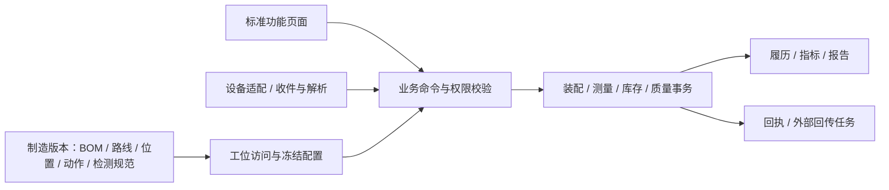

# MES 开发对象、接口与验收契约 v0.2

日期：2026-10-22。以下为建议开发基线，尚未实现。产品方向以用户确认的标准功能页面、业务配置化、无表单引擎、无电子签名认证为准。工艺领域依据见[行业设计](../product/pack-domain-design.md)，来源代码处理见[逐项复用审查](../architecture/edhr-reuse-audit.md)。

## 1. 执行结构与边界

初期沿用模块化单体与PostgreSQL。设备适配可独立进程部署；不要求每种工艺一个微服务。人工与设备通过不同身份进入共同的领域校验；页面和网关都不能直接写最终放行字段。

配置JSON可承载某种标准动作的有限参数；业务身份、装配、测量、库存和放行必须有可约束、可查询的独立记录，不能只存在一大段页面values或对象state_json中。

## 2. 逻辑数据对象与最小字段

名称为设计名，实际迁移时可调整。共用字段：id、工厂/部署范围、创建/更新时间、创建人或设备来源；正式记录增加业务关联、配置版本和不可重复业务键。金额无本期需求，不扩展成本核算。

| 对象 | 最小业务字段 | 约束/索引与来源 |
|---|---|---|
| material / product | code、type、unit、trackingMode、supplierAliases、status | 延续物料主数据；SN/BATCH/NONE明确；码在其命名空间唯一 |
| manufacturing_version | productId、version、status、effectiveRange、bomVersion、routeVersion、assemblySpec、testSpec、actionConfig、sopRefs | 发布后引用不可静默改写；保存内容快照/摘要；不含必填dhrTemplateVersionId |
| bom_line | versionId、materialId、quantity、unit、operationId、substitutePolicy、trackingMode | 正用量/单位校验；替代规则有生效范围 |
| assembly_slot | specVersion、slotCode、parentSlot、materialRule、orientation、count、diagramPosition | 版本内位置唯一；禁止循环；物理位置稳定编号 |
| electrical_mapping | specVersion、physicalSlot、seriesGroup、parallelMember、board/channel、polarity | 根据产品规范校验完整性/唯一性，不能从数组下标推导物理位置 |
| operation_action_config | versionId、routeNodeId、actionCode、actionType、sequence/prerequisites、required、role、specRefs、settings | 同工序动作编码唯一；只有已实现类型可发布；适用条件有限且可解释 |
| work_order / dispatch | orderNo、sourceId、product、version、quantity、plannedWindow；line、shift、assignedQuantity | 复用工单骨架；来源消息去重；调整检查已分配/已开工对象 |
| station / resource | stationCode、line、allowedOperations、equipmentGroup、fixture/channel、status | 工位与工序分开；设备通道/治具占用独立 |
| station_session | station、equipment、operator、workOrder、version、openedAt、closedAt、readinessState | 记录换单、清料、首件；不能只用浏览器localStorage保存现场上下文 |
| trace_object | namespace、objectNo、type、material、sourceOrder/supplierBatch、manufacturedVersion、productionState、qualityState | namespace+objectNo唯一；外购件可无内部生产工单；不强制生成DHR |
| object_alias | objectId、namespace、alias、source | 别名唯一映射；冲突不得覆盖旧对象 |
| station_visit | objectId、routeNodeId、stationSession、visitNo、kind、configSnapshotId、state、startedAt、endedAt、revision | 初次/复测/返工分别编号；唯一活动访问策略按资源确认；事务校验revision |
| action_run | visitId、actionCode、attemptNo、state、actor/source、start/end、evidenceRefs | visit+action+attempt唯一；重试通信不增加attempt，真实重新加工增加 |
| assembly_link | parentId、childId、slot、assembledAt、removedAt、assemblyRevision、visit/action、reworkId、reason | 有效子件父归属唯一、位置占用唯一；成环校验；旧关系保留 |
| carrier_assignment | carrier/fixture/channel、slot、objectId、validFrom/to、deviceRunId | 有效资源位置唯一；按发生时点关联晚到报文 |
| test_run | actionRunId、deviceId、externalRunId、program/version、specVersion、start/end、deviceResult、mesResult、status、rawFileRefs | 设备+运行ID唯一；明确初次/复测；设备原始结果不可编辑 |
| measurement | testRunId、parameterCode、position/channel、sampleIndex、rawValue/unit、normalizedValue/unit、conversionVersion、limits、result | 规定测项和采样维度唯一；数值精度不丢失；缺值与零不同；保留原始表示 |
| material_lot / load | batch/container、material、quantity/unit、expiry、opened/mixedAt、qualityState；stationSlot、order、loadedAt | 胶料等有效窗口独立；载具/库存位置不混为产品组成 |
| inventory_transaction | businessKey、type、lot/container、quantity/unit、from/to、workOrder、actionRun、reversalOf、reason | businessKey唯一；账面余额与流水同事务；冲销新增，不删原流水 |
| process_hold | object/deviceRun、holdType、startEvidence、requiredWindow、actualStart/end、state | 时间来源明确；中断与恢复有事件；批设备成员集合留版本 |
| software_execution | actionRun、componentId、targetPackage/hash、hardwareVersion、readBackVersion、toolJob、status、evidence | 区分下发/烧录/核验；失败不可自动当成功；无需人员签名表 |
| defect / quality_hold | object/position、sourceRun、reason、detectedAt、scope、status、disposition | 失败事实与质量锁定分开；祖先影响有明确对象清单 |
| rework_order / evidence_validity | object、reason、allowedActions、replacementLinks、requiredRetests、status；evidenceId、validForRevision、invalidatedBy | 旧结果不修改，只记录当前适用性；复测覆盖本次结构/配置变化 |
| business_approval | businessType/id、businessRevision、requestedBy、assignedRole/person、decision、opinion、decidedBy/At、status | 从认证上下文取操作人；批准绑定内容版本；内容变更后原批准不能授权新内容；无signatureId |
| release_record / delivery_snapshot | object、assemblyRevision、manufacturingVersion、requiredEvidence、exceptions、releasedBy/At、snapshot/hash | 生产完成/质量放行/交付独立；冻结的出厂快照不随返修覆盖 |
| print_job / package_link | object、labelVersion、payloadSnapshot、printer、attempt/result、reprintReason；package、member、validFrom/to | 打印重试不创建SN；包装唯一有效归属；打印回执与贴标复核分开 |
| inbox_message / outbox_task | source、messageId、businessRunKey、schemaVersion、payload/hash、occurredAt、receivedAt、status、error、attempt、correlationId | source+messageId唯一；同ID不同载荷报冲突；不同消息同业务运行也需领域去重 |
| audit / attachment | actorType/id、action、businessObject、before/after或差异、reason、timestamp、correlation；文件元数据/内容hash/访问范围 | 复用基础结构后扩展；关键证据与业务一致提交；附件存在不等于内容经审核 |

落库约束示例：序列化件采用可唯一定位的最小槽位；配置中的“同类件数量”展开为位置集合或明确的位置内序号，再以有效关系的带条件唯一索引保护子件与具体槽位。跨对象绑定先按固定顺序锁定对象再校验；一次事务中的绑定、库存/消耗和状态变更共享业务键。具体索引和锁方案在所选切片验证，不能仅以页面检查代替。

## 3. 状态与完成条件

| 维度 | 建议状态 | 迁移规则 |
|---|---|---|
| 制造版本 | DRAFT → PUBLISHED → RETIRED | 已发布被引用版本只允许停用/新版本；修改审批中的内容须重新校验 |
| 工位访问 | OPEN → RUNNING → COMPLETED / ABORTED | 完成表示该次执行记录封闭；其质量结果仍可为NG，不代表可进入下道工序 |
| 动作运行 | READY → RUNNING → PASSED / FAILED / ERROR / CANCELLED | FAILED是业务检测不合格；ERROR是采集/执行异常；必需动作的有效通过集合决定正常出站 |
| 测试数据 | WAITING → RECEIVED → VALIDATED / REJECTED | 接收不等于业务接受；REJECTED可因SN/通道/配置不匹配，原报文仍保留 |
| 生产状态 | CREATED → IN_PROCESS → COMPLETED；另有TERMINATED | 完工不自动变成质量放行；报废由质量处置控制，不伪装成合格完工 |
| 质量状态 | PENDING / ACCEPTED / HOLD / REWORK / SCRAPPED | ACCEPTED必须满足当前装配/配置的有效证据；处置后才解除HOLD |
| 返修单 | OPEN → AUTHORIZED → IN_PROGRESS → RETEST_PENDING → CLOSED | 未齐复测、未处理拆出件/耗损不能关闭；批准不是自动复测通过 |
| 回传任务 | PENDING → SENDING → CONFIRMED / RETRY / CONFLICT | 以对方业务回执确认，不用网络请求成功替代入库/报工成功 |

页面按钮由后端返回可执行动作及拒绝原因；直接请求相同接口必须得到同样校验结果。不存在“修改状态下拉框就让SN合格”的管理入口。

NG保存路径：测试运行记FAILED → 该次动作/访问形成真实记录 → 创建/更新质量锁定 → 正常转序被拒绝 → 进入处置/返修。访问可按异常结束流程封闭，不能因“未通过正常出站”而丢失已完成加工的事实。需要移入维修区时走返修授权，不开放正常生产放行。偏差许可单独记录范围和期限，不能变更原始NG。

## 4. 业务接口建议

以下URL/字段为新设计，尚不存在于源码；实际实现可以按现有API风格调整，但业务含义与约束需保留。

| 接口族 | 关键请求/返回 | 服务端效果 |
|---|---|---|
| `POST /mes/manufacturing-versions/{id}/validate`、`/publish` | versionRevision；逐项校验结果 | 校验BOM/动作/规范/位置/资源引用；发布冻结 |
| `POST /mes/station-sessions/open`、`/{id}/change-order` | station、equipment、workOrder、requestedVersion | 从身份/资源授权检查准备、首件、余料；返回固定上下文 |
| `POST /mes/visits/check-in` | sessionId、barcode、requestId | 解析对象与路线资格、选择发布配置；返回visitId、revision、动作列表、拦截原因 |
| `POST /mes/visits/{id}/actions/{code}/start` | expectedRevision、requestId | 创建/恢复本次动作运行；设备准备不就绪则拒绝 |
| `POST /mes/assemblies/bind` | parent、childBarcode、slot、visit/actionRun、expectedAssemblyRevision、requestId | 身份/兼容/占用校验，原子建立关系与相关事务 |
| `POST /mes/material-loads`、`/returns` | session、slot、container、quantity/unit、requestId | 校验BOM/效期/剩余量；记录真实上/退料 |
| `POST /mes/manual-inspections`、`/confirmations` | actionRun、specVersion、逐项结果/原因/附件、expectedRevision、requestId | 限定已配置检查项/角色；不能提交设备专属结果伪装采集 |
| `POST /mes/device-events` | 统一消息信封与类型化payload | 校验设备身份/资源、消息幂等、业务运行键、SN/时间/版本；返回持久化收件结果或最终业务结果 |
| `GET /mes/device-events/{source}/{messageId}` | correlation | 读持久化处理状态；便于超时后查询，不重放物理加工 |
| `POST /mes/visits/{id}/complete` | expectedRevision、requestId | 校验必需动作/测量/装配/质量；返回完成事实、质量状态、下一步许可，三者分开 |
| `POST /mes/quality-holds`、`/dispositions`、`/approvals/{id}/decisions` | 对象范围、原因、决定、expectedBusinessRevision | 登录人和角色鉴权；记录理由、证据和结果；无签名请求 |
| `POST /mes/rework-orders/{id}/replace`、`/close` | oldChild/newChild、slot、reason、复测依据、requestId | 结束旧装配，建立新关系，失效相关测试，更新材料去向；复测齐后关闭 |
| `GET /mes/trace/{objectId}`、`POST /mes/trace/impact-query` | view=current/history/delivery、asOf、批次/设备/程序条件 | 返回有时点的结构和证据；显示外部追溯缺口 |
| `POST /mes/releases`、`/print-jobs`、`/package-links` | object、证据版本/标签/包装、requestId | 放行、打印、装箱分别事务与权限；不可互相隐式替代 |
| `POST /mes/integrations/{system}/imports`、`GET /.../reconciliation` | 来源单号/版本/消息、映射版本 | 重复/撤销/变更对账；主数据归属策略可解释 |

设备消息信封建议：`sourceId, messageId, schemaVersion, eventType, externalRunId, stationId, equipmentId, channelId, objectCode/carrierCode, visitId/actionRunId（设备支持时）, recipeId/version, occurredAt, deviceSequence, payload`。服务器补receivedAt、payloadHash、关联结果及处理状态。设备不支持某字段时，适配方案必须给出可靠关联方式，不盲目把“当前页面SN”写入报文。

回执分为**已持久化接收**与**业务已接受/拒绝**；设备需要哪个状态才能继续由握手协议明确。只有业务所需事务已可靠提交，才能返回可用于继续生产的成功回执。中间消息排队成功不得当成出站许可。

## 5. 关键异常与恢复策略

| 场景 | 行为 |
|---|---|
| 相同messageId和载荷再次到达 | 返回原处理结果；不重复绑定、扣料、产出 |
| 同messageId不同载荷 | 冲突隔离、报警/待办，禁止覆盖 |
| 不同messageId但相同设备运行ID | 用业务运行键判重；若是更正须显式引用原记录，不默认为新加工 |
| 结果先于check-in到达 | 暂存未关联证据；核对发生时点、载具/通道、订单后关联，禁止自动套当前SN |
| 工艺版本已升级 | 已开工使用冻结版本；新对象按生效规则选择；禁止用新阈值静默重算旧放行 |
| 设备时间明显异常/未知时区 | 保留设备原始时间与接收时间，标记时间质量；时间窗判定按明确策略，不伪造精确时序 |
| 操作中断但设备已实际加工 | 恢复设备任务/结果查询；按业务状态补记，不能数据库回滚后直接重复真实加工 |
| 断网 | 默认关键关口不授予新许可；已授权任务与离线任务分别定义；恢复校验版本、资源占用和结果冲突 |
| 多工位并发扫码同一件 | 服务器锁与唯一约束保护，返回当前占用上下文；不靠浏览器“忙碌”标志 |
| 附件/曲线上传失败 | 结果可暂存待补证据；规范要求该证据时不能完成放行；重传关联原运行 |
| 审批后对象被换件/改配置 | 批准绑定业务修订失效，重新评估；操作员确认不能自动延续旧批准 |
| ERP/WMS失败 | 本地生产事实保留，外部状态为待确认/冲突；以重试/对账收敛，不重复生产事务 |

## 6. 开发验收清单

| ID | 场景与通过标准 |
|---|---|
| AC01 | 全新MES库无表单/DHR模板、签名认证数据，仍可登录、发布制造版本并开始模拟生产 |
| AC02 | 登录/个人设置/系统策略/用户管理均无签名密码、手写签名、身份证认证或强制认证跳转 |
| AC03 | 无作业模板也可配置并执行工序动作；不支持的动作和缺失必需规范在发布前报错 |
| AC04 | 操作员直接调用无权接口失败；设备账号不能批准偏差、修改人员或执行人工处置 |
| AC05 | 两个请求并发绑定同一子件只成功一次；没有重复扣料；父子循环和错槽位被拒绝 |
| AC06 | A/B错型、电气通道映射错误、必需通道缺失均不被总OK掩盖 |
| AC07 | 锁附/焊接同一有效结果不能满足多个点位；重传不增加尝试；真实返修增加新尝试 |
| AC08 | 胶料开封超时、点胶至合装超窗、保压中断分别产生明确异常，不自动调整时间 |
| AC09 | 液冷和箱体、不同阶段气密证据不可混用；参数单位和方法不符不能通过 |
| AC10 | 设备NG、缺数、解析异常与人工检验NG分别保存并拦截；更正保留原值/来源 |
| AC11 | BMS目标版本与实读不一致时阻断；外购预编程BMS可按配置只做核验 |
| AC12 | 长时充放电任务断连/重启后正确续查；错通道结果不关联；Ah和Wh指标明确 |
| AC13 | ACK丢失、重复消息、同ID不同内容、同运行不同ID均有确定且不重复的处理 |
| AC14 | 晚到载具报文仍关联发生时的SN；无法可靠关联时进入核对队列 |
| AC15 | 换芯/换BMS/开盖后按配置使相关测试待复核；旧NG/旧装配仍可查询 |
| AC16 | 无电子签名也能执行合法业务审批；审批意见、操作者与版本完整；内容变更后旧批准不可复用 |
| AC17 | 复测合格不增加成品产量，也不改写首次通过率；生产完成不等于质量放行 |
| AC18 | 标签重印不创建新SN；有质量锁定不能正常交付；交付快照可复原当时装配与证据 |
| AC19 | 第二种产品更换装配数量/路线/测项，通过配置运行，无需复制业务引擎或页面 |
| AC20 | 迁移后原因/文档/设备删除保护不查询已排除的表单/DHR表；菜单和权限不会自动恢复旧入口 |
| AC21 | 数据库、文件、未处理消息联合恢复可对账；实际节拍、容量与恢复目标在确认数值后验证 |

AC01–21是拟定验收，没有在本轮执行。上线前还需实际设备联调、产线操作验证和真实产品规范验收；目前足以拆分基础工程及模拟闭环开发任务，不足以宣称生产配置已冻结。
