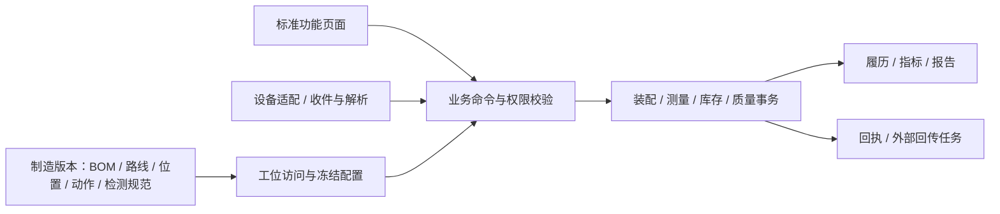

# MES 开发对象、接口与验收契约 v0.4

日期：2026-10-23。以下为完整产品建议基线；R1-01核心子集的实际实现、接口与验证边界见[实现说明](r1-01-implementation.md)，不能视为本表全量已实现；其中单客户私有化、多租户/多工厂/多车间/多产线、人工/半自动/已有产线MES协同三模式及混用为U1明确的必选目标。产品方向为标准功能页面、业务配置化、无表单引擎、无电子签名认证。工艺领域及S1/S2/S4/S5读取边界见[行业设计](../product/pack-domain-design.md)与[调研报告](../research/materials-and-reuse-assessment.md)。本版新增S7静态原型所支持的精选业务设计，页面/批注与冲突见[PR01–PR09](../research/prototype-business-review.md)，不代表原型交互或接口已通过验证；来源代码处理见[逐项复用审查](../architecture/edhr-reuse-audit.md)。

## 1. 执行结构与边界

初期沿用模块化单体与PostgreSQL。设备适配可独立进程部署；不要求每种工艺一个微服务。人工与设备通过不同身份进入共同的领域校验；页面和网关都不能直接写最终放行字段。

配置JSON可承载某种标准动作的有限参数；业务身份、装配、测量、库存和放行必须有可约束、可查询的独立记录，不能只存在一大段页面values或对象state_json中。

### 1.1 范围身份、运行模式与执行责任

单客户私有化是部署形式，不取消多租户能力；租户不可默认等于客户法人或工厂。组织模型支持租户及工厂—车间—产线—工位/资源层级，租户具体业务定义、隔离实现和跨厂共享策略在实施时确认。人员、设备、外部产线MES分别认证，并将租户及授权组织范围绑定到可信服务端身份；请求中scope字段须与该身份及业务对象交叉验证，不能仅相信客户端传值。查询、命令、缓存、后台任务、导出、附件下载及消息处理均执行相同范围约束，跨范围共享须显式授权。

运行模式按路线节点/资源配置为人工执行、半自动执行、产线MES协同，三种均为必选且可同厂同线混用。无产线MES时本产品提供扫码、检验、作业确认和报工闭环；半自动时设备结果绑定到正确访问、动作、通道/点位及冻结程序；已有产线MES时通过约定业务接口协调工单、版本、执行事实、质量和追溯。设备加工控制及安全仍归设备；S4原WebAPI协同场景不变成直采PLC的硬性要求，厂级下单/质量汇总/ERP协同也不等于建设APS。

每个有效执行范围/路线节点只能存在一个执行主责，且分别声明装配绑定、过站、消耗记账的权威写入方；另一端只能接收或委托，不因接收汇总再次产生绑定、扣料、产量。制造版本与工单快照保持统一，外部字段和路线映射保留版本。中途接管和模式迁移须先核对在制、活动任务、未决消息、装配、消耗和版本；授权后生成责任修订及生效时点。旧主责晚到事件依发生时有效责任关联，冲突隔离；不重放已发生的物理加工，不产生二次业务效果。

## 2. 逻辑数据对象与最小字段

名称为设计名，实际迁移时可调整。共用字段：id、tenantId及适用的factoryId/workshopId/lineId/stationId、创建/更新时间、创建人或设备/外部系统来源；生产事实有明确工厂及执行资源，层级归属由服务端校验，允许线外资源明确归属而不伪造产线。共享主数据声明所有者范围和授权使用范围，不强行归入虚拟工厂，也不以空tenantId代表全局可见。正式记录增加业务关联、配置/责任版本和不可重复业务键。编码、消息去重、索引、缓存键和附件存储/下载授权均纳入所属范围；下表简写未重复列出这些共用项。金额无本期需求，不扩展成本核算。

| 对象 | 最小业务字段 | 约束/索引与来源 |
|---|---|---|
| tenant / factory / workshop / line / scope_grant | 稳定ID、code/name、父级归属、status；人员/设备/系统主体、授权范围、用途、生效期 | 租户与工厂独立建模；层级一致；不能用显示名称解析权限；跨厂共享有显式授权 |
| execution_assignment / responsibility_change | routeVersion/nodeId、resourceScope、mode、executionOwner、bindingWriter、passWriter、consumptionWriter、revision、validFrom/to；在制核对清单、批准、迁移结果 | 同范围节点有效责任唯一且完整；迁移冻结/核对活动任务和未决消息；保留发生时责任以处理晚到事件 |
| external_mapping / order_snapshot | sourceSystem、sourceScope、externalOrder/version、externalRoute/nodeCode、internalOrder/nodeId、mappingVersion；制造版本及派工内容快照 | 外部与内部作用域显式映射；不按裸工序码合并；同一工单执行基线可追到统一制造版本 |
| material / product | code、type、unit、trackingMode、supplierAliases、status | 延续物料主数据；SN/BATCH/NONE明确；码在其命名空间唯一 |
| manufacturing_version | productId、version、status、effectiveRange、bomVersion、routeVersion、assemblySpec、testSpec、actionConfig、sopRefs | 发布后引用不可静默改写；保存内容快照/摘要；不含必填dhrTemplateVersionId |
| bom_line | versionId、materialId、quantity、unit、operationId、substitutePolicy、trackingMode | 正用量/单位校验；替代规则有生效范围 |
| assembly_slot | specVersion、slotCode、parentSlot、materialRule、orientation、count、diagramPosition | 版本内位置唯一；禁止循环；物理位置稳定编号 |
| electrical_mapping | specVersion、physicalSlot、seriesGroup、parallelMember、board/channel、polarity | 根据产品规范校验完整性/唯一性，不能从数组下标推导物理位置 |
| operation_action_config | versionId、routeNodeId、actionCode、actionType、sequence/prerequisites、required、role、specRefs、settings | 同工序动作编码唯一；只有已实现类型可发布；适用条件有限且可解释 |
| work_order / dispatch | orderNo、sourceId、product、manufacturingVersion、orderSnapshotId、quantity、plannedWindow；line、shift、assignedQuantity | 复用工单骨架；来源消息去重；人工/设备/产线MES引用同一冻结基线；调整检查已分配/已开工对象 |
| station / resource | stationCode、line、allowedOperations、equipmentGroup、fixture/channel、status | 工位与工序分开；设备通道/治具占用独立 |
| station_session | station、equipment（人工工序可不适用）、operator、workOrder、orderSnapshotId、version、mode、responsibilityRevision、openedAt、closedAt、readinessState | 记录换单、清料、首件；纯人工工序不伪造设备，适用性取自发布配置；设备/人工来源明确；不能只用浏览器localStorage保存现场上下文 |
| trace_object | namespace、objectNo、type、material、sourceOrder/supplierBatch、manufacturedVersion、productionState、qualityState | namespace+objectNo唯一；外购件可无内部生产工单；不强制生成DHR |
| object_alias | objectId、namespace、alias、source | 别名唯一映射；冲突不得覆盖旧对象 |
| station_visit | objectId、routeVersion/nodeId、stationSession、visitNo、kind、configSnapshotId、orderSnapshotId、responsibilityRevision、state、startedAt、endedAt、revision | 初次/复测/返工分别编号；唯一活动访问策略按资源确认；事务校验revision；显示工序码不单独作为主键 |
| action_run | visitId、actionCode、attemptNo、state、actor/source、start/end、evidenceRefs | visit+action+attempt唯一；重试通信不增加attempt，真实重新加工增加 |
| assembly_link | parentId、childId、slot、assembledAt、removedAt、assemblyRevision、visit/action、reworkId、reason | 有效子件父归属唯一、位置占用唯一；成环校验；旧关系保留 |
| carrier_assignment | carrier/fixture/channel、slot、objectId、validFrom/to、deviceRunId | 有效资源位置唯一；按发生时点关联晚到报文 |
| test_run | actionRunId、deviceId、externalRunId、program/version、specVersion、start/end、deviceResult、mesResult、status、rawFileRefs、supersedes/retestOf | 范围+设备/来源+运行ID唯一；原始测量/设备原判、MES规则判定、复测/更正、最终放行分别保存；原记录不可覆盖 |
| measurement | testRunId、parameterCode、position/channel、sampleIndex、rawValue/unit、normalizedValue/unit、conversionVersion、limits、result | 规定测项和采样维度唯一；数值精度不丢失；缺值与零不同；保留原始表示 |
| material_lot / load | batch/container、material、quantity/unit、expiry、opened/mixedAt、qualityState；stationSlot、order、loadedAt | 胶料等有效窗口独立；载具/库存位置不混为产品组成 |
| inventory_transaction | businessKey、physicalConsumptionId、writer、responsibilityRevision、type、lot/container、quantity/unit、from/to、workOrder、actionRun、reversalOf、reason | 作用域内业务键/实际消耗事件去重；账面余额与流水同事务；重传和无新增消耗复测不扣料；返工补料独立；冲销新增，不删原流水 |
| process_hold | object/deviceRun、holdType、startEvidence、requiredWindow、actualStart/end、state | 时间来源明确；中断与恢复有事件；批设备成员集合留版本 |
| software_execution | actionRun、componentId、targetPackage/hash、hardwareVersion、readBackVersion、toolJob、status、evidence | 区分下发/烧录/核验；失败不可自动当成功；无需人员签名表 |
| defect / quality_hold | object/position、sourceRun、reason、detectedAt、scope、status、disposition | 失败事实与质量锁定分开；祖先影响有明确对象清单 |
| rework_order / evidence_validity | object、reason、allowedActions、replacementLinks、requiredRetests、status；evidenceId、validForRevision、invalidatedBy | 旧结果不修改，只记录当前适用性；复测覆盖本次结构/配置变化 |
| business_approval | businessType/id、businessRevision、requestedBy、assignedRole/person、decision、opinion、decidedBy/At、status | 从认证上下文取操作人；批准绑定内容版本；内容变更后原批准不能授权新内容；无signatureId |
| release_record / delivery_snapshot | object、assemblyRevision、manufacturingVersion、requiredEvidence、exceptions、releasedBy/At、snapshot/hash | 生产完成/质量放行/交付独立；冻结的出厂快照不随返修覆盖 |
| print_job / package_link | object、labelVersion、payloadSnapshot、printer、attempt/result、reprintReason；package、member、validFrom/to | 打印重试不创建SN；包装唯一有效归属；打印回执与贴标复核分开 |
| inbox_message / outbox_task | scope、source、messageId、businessRunKey、responsibilityRevision、mappingVersion、orderSnapshotId、schemaVersion、payload/hash、occurredAt、receivedAt、status、error、attempt、correlationId | scope+source+messageId唯一；同ID不同载荷报冲突；不同消息同业务运行也需领域去重；未经范围/责任核验不改执行事实 |
| audit / attachment | scope、actorType/id、action、businessObject、before/after或差异、reason、timestamp、correlation；文件元数据/内容hash/所属对象与访问范围 | 复用基础结构后扩展；关键证据与业务一致提交；上传/预览/下载/导出均鉴权，不靠文件名隔离；附件存在不等于内容经审核 |
| cell_compatibility_rule / check | ruleVersion、sourceParseVersion、applicableNodes、enabled、requiredInputs、consistencyFields、week/dateSpanPolicy；parent/assemblyRevision、cellEvidenceRefs、actualSpan、result/reasons | S7 PR01；按实际N个电芯及发生时装配取数，规则与来源可追溯；ABCDE/26/52不硬编码，跨年/未知日期未定义不能假通过 |
| material_label / label_conversion | code、material/lot、quantity/unit、expiry/expiryStatus、qualityState、location、supplierRefs；sourceLabels、targetLabels、before/after、reason、inventoryBusinessKey | S7 PR04；区别产品SN；拆并数量守恒，调整差异单独授权；来源链保留，已消耗/失效标签不能重复拆并；未知效期不自动可用 |
| material_order_transfer / replacement_record | source/targetOrderSnapshot、lot/label、remainingQuantity、from/to、reason；originalConsumption、replaced/dismantledQuantity、newLot/child、removedDisposition、reworkRef、inventoryRefs | S7 PR04/05；余料归属转移不改历史消耗；累计替换不超尚可替换量，回收质量/去向明确；不重复冲销或生成可用库存 |
| production_report / report_line / reporting_policy | reportNo、sourceFacts、order/node、type、revision；lineNo、material/lot、quantity/unit、externalTask/voucher/result；mode、applicableOrderTypes、exclusions、effectiveRange | S7 PR03；报工与原始执行事实分开，更正留理由/权限/版本和冲销；人工/自动同事实不重复；SAP及仅量产为历史策略样例 |

S7 PR06的异常主记录可关联多个NG子项及原始测试/访问；处理状态、返修任务、质量锁定分别留记录，不以修改主记录为已处理自动关闭全部NG。批量返工保存每件原工序、目标工序、任务、拒绝原因及结果；相同料号/目标工单/工序段的组批条件与每件路线可达性分别校验。

落库约束示例：序列化件采用可唯一定位的最小槽位；配置中的“同类件数量”展开为位置集合或明确的位置内序号，再以有效关系的带条件唯一索引保护子件与具体槽位。跨对象绑定先按固定顺序锁定对象再校验；一次事务中的绑定、库存/消耗和状态变更共享业务键。具体索引和锁方案在所选切片验证，不能仅以页面检查代替。

路线节点用稳定ID与路线/版本关联；S5两表P030语义不同，外部映射至少包含来源、来源范围、路线及版本，不能把裸P030作为跨路线主键。S1“首次/每次扣料”的冲突按实际消耗契约化解，不以报文次数决定扣料。模组来源工单与PACK目标工单可不同，绑定校验目标工单执行一致性、投料授权、齐套和不重复，保留来源单，不强行改写为同单。

## 3. 状态与完成条件

| 维度 | 建议状态 | 迁移规则 |
|---|---|---|
| 制造版本 | DRAFT → PUBLISHED → RETIRED | 已发布被引用版本只允许停用/新版本；修改审批中的内容须重新校验 |
| 工位访问 | OPEN → RUNNING → COMPLETED / ABORTED | 完成表示该次执行记录封闭；其质量结果仍可为NG，不代表可进入下道工序 |
| 动作运行 | READY → RUNNING → PASSED / FAILED / ERROR / CANCELLED | FAILED是业务检测不合格；ERROR是采集/执行异常；必需动作的有效通过集合决定正常出站 |
| 测试数据 | WAITING → RECEIVED → VALIDATED / REJECTED | 接收不等于业务接受；REJECTED可因SN/通道/配置不匹配，原报文仍保留 |
| 生产状态 | CREATED → IN_PROCESS → COMPLETED；另有TERMINATED | 完工不自动变成质量放行；报废由质量处置控制，不伪装成合格完工 |
| 质量状态 | PENDING / ACCEPTED / HOLD / REWORK / SCRAPPED | ACCEPTED必须满足当前装配/配置的有效证据；处置后才解除HOLD |
| 返修单 | OPEN → AUTHORIZED → IN_PROGRESS → RETEST_PENDING → CLOSED | 未齐复测、未处理拆出件/耗损不能关闭；批准不是自动复测通过 |
| 回传任务 | PENDING → SENDING → CONFIRMED / RETRY / CONFLICT | 以对方业务回执确认，不用网络请求成功替代入库/报工成功 |

页面按钮由后端返回可执行动作及拒绝原因；直接请求相同接口必须得到同样校验结果。不存在“修改状态下拉框就让SN合格”的管理入口。

NG保存路径：测试运行记FAILED → 该次动作/访问形成真实记录 → 创建/更新质量锁定 → 正常转序被拒绝 → 进入处置/返修。访问可按异常结束流程封闭，不能因“未通过正常出站”而丢失已完成加工的事实。需要移入维修区时走返修授权，不开放正常生产放行。偏差许可单独记录范围和期限，不能变更原始NG。

设备原判、MES规则判定及最终放行是不同维度；设备NG但MES数值判定通过时必须保留冲突并进入已定义处置，不能静默只看MES。复测是新尝试，显示其与原始运行的关系和当前有效性；更正保留原值/单位/判定、原因、来源及版本。S1审厂弱防错不作为默认正常生产模式。

有效检验完成须有已确认规范及全部必需证据；所需判定限值为TBD、必填项缺失或来源不明不能由总OK或页面完成标记掩盖。纯人工工序采用明确人工检验规则并标识来源，不伪造PLC/设备OK；非数值检查项无需虚构数值阈值。页面分开展示加工事实、证据完整性、同步状态和业务放行；断连时显示待同步/冲突等实际状态。S1§4.1.5修改数据主题第47页（87页阅读版，详见调研报告）选择性更新合格的流程不直接照搬，原值、修正、复测、处置形成独立历史，当前判定须按发布策略解释；按规则已失效的旧OK不能继续授权放行。统计分别计量唯一产品、执行尝试、重测和返工，不以重复上传或复测扩增产品数。

原型补充边界：返工处置只许可指定返修路径，让步仅在授权范围/期限内有效；存在其它未闭环NG时不得正常出站。报工策略的开关/排除清单仅控制报工触发，不删除执行、质量或消耗事实。线边收料申请、出库、实际接收与上机分别保存状态；ERP请求成功不等于业务入账成功。

## 4. 业务接口建议

以下URL/字段为完整产品建议设计；R1-01实际采用实现说明中的`/api`命令接口，不能将建议URL当作已存在接口。实现可以调整API风格，但业务含义与约束需保留。

| 接口族 | 关键请求/返回 | 服务端效果 |
|---|---|---|
| `POST /mes/manufacturing-versions/{id}/validate`、`/publish` | versionRevision；逐项校验结果 | 校验BOM/动作/规范/位置/资源引用；发布冻结 |
| `POST /mes/station-sessions/open`、`/{id}/change-order` | station、equipment、workOrder、requestedVersion、requestId | 从身份/资源授权检查准备、首件、余料；同一会话重复选择同一有效工单幂等返回当前上下文，不触发清料/换单；真实换单执行在制/余料检查 |
| `POST /mes/visits/check-in` | sessionId、barcode、requestId | 解析对象与路线资格、选择发布配置；返回visitId、revision、动作列表、拦截原因 |
| `POST /mes/visits/{id}/actions/{code}/start` | expectedRevision、requestId | 创建/恢复本次动作运行；按发布配置核验人工或设备准备条件，必需设备未就绪则拒绝；纯人工动作不要求虚拟设备回执 |
| `POST /mes/assemblies/bind` | parent、childBarcode、slot、visit/actionRun、expectedAssemblyRevision、requestId | 身份/兼容/占用校验，原子建立关系与相关事务 |
| `POST /mes/material-loads`、`/returns` | session、slot、container、quantity/unit、requestId | 校验BOM/效期/剩余量；记录真实上/退料 |
| `POST /mes/manual-inspections`、`/confirmations` | actionRun、specVersion、逐项结果/原因/附件、expectedRevision、requestId | 限定已配置检查项/角色；不能提交设备专属结果伪装采集 |
| `POST /mes/device-events` | 统一消息信封与类型化payload | 校验设备身份/资源、消息幂等、业务运行键、SN/时间/版本；返回持久化收件结果或最终业务结果 |
| `GET /mes/device-events/{source}/{messageId}` | correlation | 读持久化处理状态；便于超时后查询，不重放物理加工 |
| `POST /mes/visits/{id}/complete` | expectedRevision、requestId | 校验必需动作/测量/装配/质量；返回完成事实、质量状态、下一步许可，三者分开 |
| `POST /mes/quality-holds`、`/dispositions`、`/approvals/{id}/decisions` | 对象范围、原因、决定、expectedBusinessRevision | 登录人和角色鉴权；记录理由、证据和结果；无签名请求 |
| `POST /mes/rework-orders/{id}/replace`、`/close` | oldChild/newChild、slot、reason、复测依据、requestId | 结束旧装配，建立新关系，失效相关测试，更新材料去向；复测齐后关闭；批量返工逐项返回成功/失败及原因，不用整体OK掩盖失败项 |
| `GET /mes/trace/{objectId}`、`POST /mes/trace/impact-query` | view=current/history/delivery、asOf、批次/设备/程序条件 | 返回有时点的结构和证据；显示外部追溯缺口 |
| `POST /mes/releases`、`/print-jobs`、`/package-links` | object、证据版本/标签/包装、requestId | 放行、打印、装箱分别事务与权限；不可互相隐式替代 |
| `POST /mes/integrations/{system}/imports`、`GET /.../reconciliation` | 来源单号/版本/消息、映射版本 | 重复/撤销/变更对账；主数据归属策略可解释 |
| `POST /mes/integrations/{system}/execution-events` | scope、映射/责任版本、工单快照、外部运行键、绑定/过站/消耗事实与证据 | 校验执行主责及各类写入方；接收外部事实不触发第二次本地扣料/报产；返回收件与业务处理状态 |
| `POST /mes/execution-assignments/{id}/migrations`、`/{id}/activate` | expectedRevision、目标模式/主责、在制及消息核对、原因/批准 | 核对活动任务与未决事实；受控生效责任修订；未核对或冲突未处置不得接管 |
| `POST /mes/material-labels/conversions`、`/mes/material-order-transfers` | source/targetLabels或旧/新任务、数量/单位、expectedRevision、reason、requestId | 按效期/质量/批次/余额规则原子记拆并或余料归属迁移；重传返回原结果，不生成第二次消耗；不提供任意改账面数入口 |
| `POST /mes/production-reports`、`/{id}/corrections`、`GET /.../{id}/reconciliation` | 来源事实/修订、行项目、数量/单位、原因/授权、requestId；外部回执/凭证 | 校验人工/自动触发资格和同事实幂等；合法更正保留原单及关联；回传失败进入待重试/对账，不覆盖本地生产事实 |

所有接口均从可信身份核验scope与资源权限，路径ID、查询条件和附件引用也须验证；操作者提交租户ID不能获得该租户权限。人工扫码/检验/报工与设备/产线MES事件采用同一业务运行去重及配置校验，保留输入来源。

设备/产线MES消息信封建议：`scope（tenantId/factoryId及适用的workshopId/lineId）, sourceId, messageId, schemaVersion, eventType, externalRunId/businessRunKey, responsibilityRevision, mappingVersion, orderSnapshotId, routeVersion/nodeId或可核对外部节点标识, stationId, equipmentId, channelId, objectCode/carrierCode, visitId/actionRunId（设备支持时）, recipeId/version, occurredAt, deviceSequence, payload`。服务器补receivedAt、payloadHash、关联结果及处理状态。设备不支持某字段时，适配端依据受控身份/映射补齐并记录推导依据；范围或业务关联不可靠时隔离，不盲目把“当前页面SN”写入报文。

回执分为**已持久化接收**与**业务已接受/拒绝**；设备需要哪个状态才能继续由握手协议明确。只有业务所需事务已可靠提交，才能返回可用于继续生产的成功回执。中间消息排队成功不得当成出站许可。

## 5. 关键异常与恢复策略

| 场景 | 行为 |
|---|---|
| 相同messageId和载荷再次到达 | 返回原处理结果；不重复绑定、扣料、产出 |
| 同messageId不同载荷 | 冲突隔离、报警/待办，禁止覆盖 |
| 不同messageId但相同设备运行ID | 用业务运行键判重；若是更正须显式引用原记录，不默认为新加工 |
| 结果先于check-in到达 | 暂存未关联证据；核对发生时点、载具/通道、订单后关联，禁止自动套当前SN |
| 工艺版本已升级 | 已开工使用冻结版本；新对象按生效规则选择；禁止用新阈值静默重算旧放行 |
| 设备时间明显异常/未知时区 | 保留设备原始时间与接收时间，标记时间质量；时间窗判定按明确策略，不伪造精确时序 |
| 操作中断但设备已实际加工 | 恢复设备任务/结果查询；按业务状态补记，不能数据库回滚后直接重复真实加工 |
| 断网/缓存恢复 | 默认关键关口不授予新许可；缓存保留范围、原业务键、快照和责任版本；已授权任务与离线任务分别定义；恢复校验权限、版本、资源占用及结果冲突，幂等补传，冲突隔离，不无条件离线放行 |
| 多工位并发扫码同一件 | 服务器锁与唯一约束保护，返回当前占用上下文；不靠浏览器“忙碌”标志 |
| 附件/曲线上传失败 | 结果可暂存待补证据；规范要求该证据时不能完成放行；重传关联原运行 |
| 审批后对象被换件/改配置 | 批准绑定业务修订失效，重新评估；操作员确认不能自动延续旧批准 |
| ERP/WMS失败 | 本地生产事实保留，外部状态为待确认/冲突；以重试/对账收敛，不重复生产事务 |
| 同工序多台并行设备/线外人工 | 按设备/通道/治具有效占用和访问关系关联；同工序可多运行并发，不以线性页面顺序判断归属；资源冲突拒绝 |
| 接管中断/旧主责晚到消息 | 保留迁移核对与责任生效时点；查询实际已做业务和设备任务后恢复；按发生时责任关联或隔离，不新建重复执行与消耗 |
| 越范围编码/消息/附件 | 拒绝或隔离并留审计；不以同码、客户端scope或共享文件URL绕过授权；合法共享须验证显式范围规则 |
| 批次/日期规则已启用但来源缺失、日期不明或跨年周次语义未定义 | 记录缺项及规则版本，不能将解析失败当相同批次或零跨度；转受控补证/评估，不猜测生产日期 |
| 标签拆并或余料切单中断 | 按原业务键查询转换、余额和任务归属；同一事务/受控待处理边界恢复，不复制标签余额、不改旧消耗 |
| 同件多NG仅部分处置或批量返工部分失败 | 其余缺陷保持锁定；逐件返回结果与待办，不能靠整体已处理或批量总OK放行 |

## 6. 开发验收清单

| ID | 场景与通过标准 |
|---|---|
| AC01 | 全新MES库无表单/DHR模板、签名认证数据，仍可登录、发布制造版本并开始模拟生产 |
| AC02 | 登录/个人设置/系统策略/用户管理均无签名密码、手写签名、身份证认证或强制认证跳转 |
| AC03 | 无作业模板也可配置并执行工序动作；不支持的动作和缺失必需规范在发布前报错 |
| AC04 | 操作员直接调用无权接口失败；设备账号不能批准偏差、修改人员或执行人工处置 |
| AC05 | 两个请求并发绑定同一子件只成功一次；没有重复扣料；父子循环和错槽位被拒绝 |
| AC06 | A/B错型、电气通道映射错误、必需通道缺失均不被总OK掩盖 |
| AC07 | 锁附/焊接同一有效结果不能满足多个点位；重传不增加尝试；真实返修增加新尝试 |
| AC08 | 胶料开封超时、点胶至合装超窗、保压中断分别产生明确异常，不自动调整时间 |
| AC09 | 液冷和箱体、不同阶段气密证据不可混用；参数单位和方法不符不能通过 |
| AC10 | 设备NG、缺数、解析异常与人工检验NG分别保存并拦截；更正保留原值/来源 |
| AC11 | BMS目标版本与实读不一致时阻断；外购预编程BMS可按配置只做核验 |
| AC12 | 长时充放电任务断连/重启后正确续查；错通道结果不关联；Ah和Wh指标明确 |
| AC13 | ACK丢失、重复消息、同ID不同内容、同运行不同ID均有确定且不重复的处理 |
| AC14 | 晚到载具报文仍关联发生时的SN；无法可靠关联时进入核对队列 |
| AC15 | 换芯/换模组/换BMS/开盖后按配置使相关测试待复核；替换前后父子谱系可还原，旧NG/旧装配仍可查询；批量返工逐项返回成功/失败及原因，失败项不标完成 |
| AC16 | 无电子签名也能执行合法业务审批；审批意见、操作者与版本完整；内容变更后旧批准不可复用 |
| AC17 | 复测合格不增加成品产量，也不改写首次通过率；生产完成不等于质量放行 |
| AC18 | 标签重印不创建新SN；有质量锁定不能正常交付；交付快照可复原当时装配与证据 |
| AC19 | 第二种产品更换装配数量N/路线/测项，通过配置运行；不固定历史图示槽位数或24位编码长度，无需复制业务引擎或页面 |
| AC20 | 迁移后原因/文档/设备删除保护不查询已排除的表单/DHR表；菜单和权限不会自动恢复旧入口 |
| AC21 | 数据库、文件、未处理消息联合恢复可对账；实际节拍、容量与恢复目标在确认数值后验证 |
| AC22 | 单客户私有化实例可配置多个租户、工厂、车间和产线；租户与客户法人/工厂无强制等同约束；范围和层级归属可核对。建议以2租户、各2工厂、多个车间/产线作为测试夹具，此数量不是产品容量承诺 |
| AC23 | 不同范围的同名/同码工单、SN和设备正确解析；越范围直接接口、消息、缓存恢复、报表导出及附件下载均被拒绝/隔离；显式授权共享按规则成功 |
| AC24 | 在同厂同线配置人工站、半自动站和已有产线MES工序并完成同一产品闭环；纯人工动作无需设备接口/虚拟回执也可完成扫码/检验/报工，半自动结果绑定正确运行；三模式均不依赖复制业务引擎 |
| AC25 | 三模式引用同一制造版本和工单快照；换型/版本升级后旧在制保留冻结基线，新对象按生效规则执行，外部映射可追溯 |
| AC26 | 同一工序有效执行主责唯一；绑定、过站、扣料写入方显式且完整；重复/双端提交不会重复绑定、记产或扣料，非主责写入被拒绝或隔离 |
| AC27 | 在制由产线MES迁到人工/半自动主责时，未核对活动任务、装配/消耗及未决消息不能激活；授权迁移后重传与旧主责晚到结果不产生二次业务效果 |
| AC28 | S5两路线同为P030但语义不同的节点独立执行和追溯；裸工序码不足以定位时拒绝，不发生跨路线套用配置或结果 |
| AC29 | 模组来源工单不同于PACK目标工单时，合法投料可绑定且保留两端单号；错目标单、前序不满足、重复子件和数量不足分别拦截 |
| AC30 | 首次消耗只记一次；通信重传及无新增消耗复测不扣料；实际返工补料/耗损独立记账；外部MES回传已记事实不重复本地消耗，冲销保留原流水 |
| AC31 | 原始值/设备原判、MES规则判定、复测/更正及最终放行分别可查；纠错同时覆盖NG→OK与OK→NG，按策略失效的旧OK不能继续放行，设备NG不被改写抹除；必需项缺失、所需限值缺失/TBD或来源不明不呈现有效检验完成；人工检验不伪造设备OK；报表区分唯一产品/尝试/重测/返工 |
| AC32 | 同一工序多台EOL/充放电设备、多个通道和线外人工可并行执行；资源占用唯一，换位/晚到/中断结果正确归属，不受每工序单设备线性假设限制 |
| AC33 | 缓存补传、服务重启和ACK丢失按原范围/业务键恢复；断连/待补传/已同步/冲突状态正确显示；权限或配置/责任版本冲突隔离；无有效授权的断网关键关口不新放行，不重放已发生物理加工 |
| AC34 | 通过产线MES业务接口完成厂级下单、执行/质量汇总和外部对账；不要求为此直控PLC或建设APS；设备动作与安全许可仍由设备系统负责，MES业务许可不可替代 |
| AC35 | 同一会话重复选同一有效工单返回当前上下文，不重复清料、换单或首件；真正换单时按在制/余料与状态规则拦截/处理；保留S1§4.1.1图文冲突的决策依据 |
| AC36 | 启用电芯批次/日期规则后，N个实际子件的标识一致性、日期/周次跨度与来源按发布版本检查；缺来源、未知日期、未定义跨年规则或超阈值不能假通过；更换N和编码解析无需改业务引擎，26/52及ABCDE不作常量 |
| AC37 | 启用物料标签拆并后，重复提交不复制数量或生成重复有效标签，来源/目标、批次、单位、质量及库存事务可对账；合并不延长效期，null/未知效期按显式策略处理，不生成产品SN或伪造装配关系 |
| AC38 | 精确件/批次件替换分别留原关系或原消耗及去向；累计替换/拆解不超剩余可替换量；回收料未评估不进入合格可用库存，入库/交付件的受控退库返修保留历史和必要外部冲销，PC/PDA执行相同规则 |
| AC39 | 同件有多个NG时只处理其中一个不能正常放行；让步超范围/过期或返工未齐证据不能代替正常出站；批量不同当前工序按料号/目标单/工序段与逐件路径判定，逐项成功失败均关联原异常与返修任务 |
| AC40 | 自动/人工报工按授权类型及排除规则触发；同一事实只报一次，合法数量更正有明细来源、理由及版本/冲销；ERP回执失败保留本地事实，重试不二次计产/扣料；单/行、业务回执与外部凭证可逐笔核对 |
| AC41 | 在定义相同对象/工序/时间窗的样例中，首测OK后复测NG仍保留首测OK，首测NG后复测OK不改写首测失败；最终结果按有效证据/处置计算；多NG原因条数不等于不良件数，WIP和欠料可下钻且不代替库存或实耗 |
| AC42 | 余料切单记录旧/新任务、批次/标签及迁移量，旧任务已耗量和历史不改变；重复切单不重复扣料，余额与实际上/退料可对账；权限、目标BOM/物料资格或余量不符时拒绝并说明原因 |

AC01–42是完整产品拟定验收；R1-01只验证实现说明列出的核心子场景，不能据此将整项AC或完整清单标为通过。AC22–35承接U1及原资料复核，AC36–42将S7 PR01–PR07的精选业务补充转为可核验场景；配置型/项目适用能力在启用后执行相应验收，不据原型全量页面扩张一期范围。建议测试夹具不是容量承诺，静态页面/批注读取也不是界面或业务测试。上线前还需实际设备/产线MES联调、三模式操作、范围隔离及真实产品规范验收。租户含义/隔离技术/共享、责任映射及离线策略可细化，但不能将多组织或三模式支持目标移为待确认；不编造并发、时延、保存期或RPO/RTO数值。
