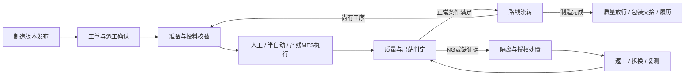
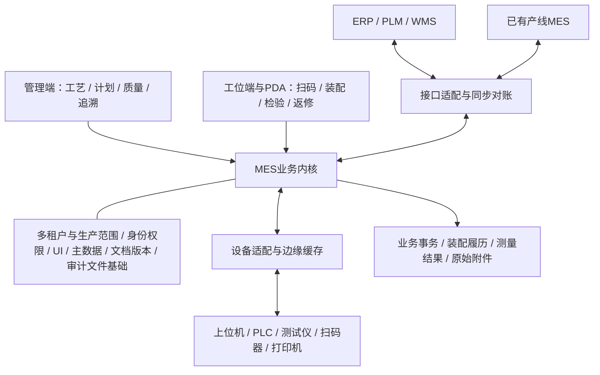

# 模组 / PACK MES 业务蓝图 v1.0

日期：2026-10-23｜状态：业务蓝图与产品规划基线，供评审；必选目标保持，现场工艺与实施细节按阶段落实。

本版保留U1及既有材料/eDHR静态审查基线，新增直接静态读取本地墨刀原型S7的业务补充。来源编号、直接读取与转述范围见[调研报告](../research/materials-and-reuse-assessment.md)，具体页面/批注及采纳边界见[原型核查PR01–PR09](../research/prototype-business-review.md)。S1–S6原附件未重新读取，飞书正文仍未取得；S7页面数据不是交互运行或接口验收证明。已确认采用配置化标准功能页面，取消通用表单及电子签名认证。下述必选能力不再作为“是否支持”的待确认项；具体工艺参数、接口协议、技术方案及增强功能排序仍需核定。开发时同时阅读[逐项复用审查](../architecture/edhr-reuse-audit.md)、[PACK行业设计](pack-domain-design.md)、[对象/接口/验收契约](../development/contracts-and-acceptance.md)。

现有资料已足以形成业务蓝图、功能矩阵和阶段规划。本版将它们收敛为产品规划基线v1.0：目标与阶段退出条件见[产品目标与阶段路线](product-goals-and-roadmap.md)，75项功能的交付阶段见[功能矩阵](function-matrix.md)。具体参数/报文未定属于对应现场实施缺口，不阻止本版规划；v1.0是文档基线，不表示软件已实现或工艺已冻结。

## 1. 产品定位与边界

为模组与PACK装配工厂提供厂级制造协同，以及从电芯/模组接收到成品下线的执行、防错、质量与追溯能力。厂级统一管理制造版本、工单派工、在制与质量汇总、ERP协同及跨线履历；无产线MES处直接承接工位执行，已有产线MES处通过集成协同。每个成品应能解释“用了什么、在哪里加工、依据什么版本、测得什么、发生过什么异常、为何允许流转”。

**单客户私有化部署必须保留，同时必选支持多租户、多工厂、多车间、多产线和多种产品。** 部署方式与逻辑管理、隔离范围是不同维度，二者兼容。本版撤销将它们视为冲突、或把多租户/多工厂是否支持列为待确认的旧判断。租户不预设等于客户、法人或工厂；具体业务含义及其与生产组织的归属关系待实施建模。每项业务须有明确租户与生产范围，按授权访问和汇总；跨租户或跨厂共享须显式授权，不能通过缺省租户绕过边界。

### 1.1 必选范围与混合运行模式

| 模式 | 产品必须承接的能力 | 执行与数据责任 |
|---|---|---|
| 无产线MES的人工站 | 工单接收、SOP、扫码装配、人工检验/确认、报工、物料和异常处理 | 本产品承担该工序执行主责；记录人员、版本、来源及证据；没有设备接口也能完成已配置的人工工艺闭环 |
| 无产线MES的半自动线 | 人工上下料/扫码与工具、测试仪、PLC或上位机结果绑定，联动工序判定 | 本产品承担该工序执行主责，经设备适配关联实际SN、访问、点位与运行；人工输入不得伪装设备采集 |
| 已有产线MES协同 | 下发/同步工单与制造版本映射，接收进度、装配、消耗和质量证据，质量处置及追溯对账 | 产线MES承担约定工序执行主责；厂级接收受控事实并协同，不重复执行绑定、过站或扣料；具体接口与放行主责在职责契约中固定 |

三种模式均为必选产品能力，可在同一工厂、同一产线的不同工序混合使用。模式按受控配置生效，不允许因为一个客户已有MES就删除人工/半自动能力，也不要求无MES工位先采购另一套MES。每个工序的执行主责唯一；绑定、过站、实际消耗各自明确写入方、业务键和回传/镜像关系。主责或模式变更须核对在制、未处理消息和余额并保留生效边界，禁止双方对同一事实各记一笔。

厂级MES V1.9（S4）原有单基地、WebAPI接联赢/速博达线体、厂级下单/质量汇总/ERP协同是历史证据，不是本产品的规模或接入上限。其原范围不直接补采PLC；本版依据U1增加无MES现场的直接执行与必要设备适配，具体驱动协议按项目核定。

### 1.2 系统职责与不包含项

| 系统 | 建议职责 | 与MES的关系 |
|---|---|---|
| ERP/PLM | 订单、物料、产品、设计BOM及其受控版本，具体主责按项目确定 | 下发工单/主数据，接收报工和消耗；同步失败可重试和对账 |
| 模组/PACK MES | 制造路线、工位执行、投料校验、装配关系、过程质量、在制与履历 | 对生产动作和业务放行作出可追溯判断 |
| 已有产线MES | 约定工序的执行、设备结果及本线原始证据 | 与厂级约定工单/制造版本映射、执行主责、绑定/过站/消耗写入方、质量许可、回执与对账；不产生双重业务效果 |
| 设备上位机/PLC/网关 | 设备运行、测量、程序执行、现场缓存与握手 | 接收业务许可/配方请求，上传实际结果；机器安全联锁仍由设备控制系统负责 |
| WMS/QMS/EAM（如果已有） | 仓储、质量体系、设备维护的相应职责 | MES先提供生产现场必要能力，按边界交换数据 |

上述职责划分参考[ISA-95官方介绍](https://www.isa.org/standards-and-publications/isa-standards/isa-95-standard)，并根据本项目目标提出。它不是要求一期实现完整ERP、APS、WMS、QMS、EAM，也不是标准认证声明。

一期默认不覆盖匀浆、涂布、辊压、注液等电芯制造过程；需要时接收上游电芯合格状态与关键参数。厂级工单与派工不等于APS，不包含高级自动排产。配组优化算法、完整设备维保、AI预测、电池护照及复杂跨厂调拨另行核定；多工厂管理本身属于必选范围。默认不提供弱化防错的“审厂模式”，不承诺所有设备协议、任意工艺脚本、无条件离线放行或未经测量的性能/收益数值。设备动作控制和安全联锁仍由设备系统负责。

### 1.3 角色、业务闭环与目标

| 角色/业务域 | 主要业务与输入 | 应形成的业务结果 | 贯穿约束 |
|---|---|---|---|
| 工艺/产品管理 | 产品、BOM、路线、装配/电气映射、动作、检测规范与SOP | 可校验发布的制造版本、适用范围和变更影响 | 已发布版本及工单执行快照不能静默改写 |
| 计划/生产管理 | 建立/导入/同步工单，按工厂/产线/班次派工与确认 | 受控任务、生产准备、在制和产出进度 | 派工与现场执行分开；跨模式交接保持唯一主责 |
| 物料/线边管理 | 物料批次/标签、接收、上退料、实际消耗和余料 | 可核对的数量、来源、质量/效期和去向 | 申请不等于到料；过站或通信次数不等于实际消耗 |
| 操作员/设备/产线MES | 按工单快照和路线完成识别、加工、装配与检验 | 某SN某次访问/动作的真实执行及原始证据 | 人工与设备来源区分，外部回传不再次绑定/过站/扣料 |
| 质量/返修 | 首件、缺陷锁定、让步、拆换、返工和复测 | 带依据的处置、有效测试集合及质量放行 | 原始NG保留，多NG逐项控制，返工许可不等于正常出站 |
| 交付/运营/运维 | 成品及包装、履历、外部回执、指标与系统状态 | 交付快照、可下钻看板、同步/恢复对账 | 完工、质量放行、入库分别管理，报表不反向生成事实 |

图中循环按发布路线和返修权限执行，不能任意改站；每步都保留租户/生产范围、制造与工单版本、唯一主责和实际证据。八项产品结果为：G01范围权限、G02三模式混合制造、G03统一制造基线、G04真实装配谱系、G05质量闭环、G06物料账实关联、G07可靠业务集成、G08可运营的标准产品。各目标的功能及验收映射以[阶段路线第2节](product-goals-and-roadmap.md#2-产品目标与可验证结果)为准。

## 2. 可标准化的产品结构

这是一张职责图，不意味着每个方框都应成为微服务。初期建议保持现有模块化单体，设备适配根据现场网络独立部署；通过明确服务接口与数据所有权减少耦合。

| 层次 | 标准化什么 | 允许变化什么 |
|---|---|---|
| 通用基础 | 租户与工厂/车间/产线范围、用户、授权、审计、版本、附件、业务审批 | 租户业务映射、隔离技术、显式共享、角色与审批范围；无通用表单和电子签名 |
| MES内核 | 单件身份、访问工位、判定、装配绑定/拆换、库存事务、质量锁定、复测 | 经版本管理的业务规则；不能关闭身份唯一性与原始证据保留 |
| 工艺模板 | 路线→工序→标准动作；扫码、检验、涂胶、保压、焊接、锁附、静置、测试、装配、包装 | 顺序、参数、位置、数量、设备组、时间要求、A/B型差异；首版不引入独立作业流程设计器 |
| 项目适配 | 产线MES/ERP映射、执行主责与写入契约、设备协议、打印驱动、外部报表 | 厂商字段和项目特有接口，通过适配层实现；不得关闭范围隔离、事实唯一性或原始证据保留 |

“标准化”应表现为同一动作和规则在不同产品配置下可运行。不能用“每换一个客户复制一套页面和数据库表”作为标准产品策略。

## 3. 主流程与工艺模板

通用业务链：

`制造版本发布 → 工单/派工 → 接料与上料 → 工位进站 → 加工/采集/装配 → 判定与出站 → 不良处置/返修复测 → 成品下线与履历 → 包装/入库交接`

工艺模板与系统业务链分开定义。下列是依据历史材料提炼的起始模板，不作为新产线冻结路线。

| 模板 | 工序示例 | 数据重点 | 来源 |
|---|---|---|---|
| 模组装配 | 电芯检验/OCV/IR → 清洁/贴片/涂胶 → 堆叠绑定/保压 → 绝缘检测/极柱处理 → CCS安装/焊接 → 静置 → 电性能/绝缘耐压/DCR → 防护/称重/下线 | 电芯来源、位置与数量、A/B型、胶料批次、测量和焊接结果、复测记录 | S2第3–5页 |
| 历史模组增补线 | 上料 → 清洗 → 组件堆叠 → 侧缝焊接 → EOL第一检测 → 顶盖焊接/CCS绑定 → EOL第二检测 | 工单匹配、过点、设备与MES双判定、换芯记录 | S1第4章 |
| PACK装配 | 箱体上线/部件预装 → 模组入箱与关联 → 冷却/电连接/锁附 → 液冷气密/绝缘 → 静动态测试 → 涂胶/合盖 → 整包气密/终检 → 容量测试/称重 → 包装入库 | 模组安装位置、关键件批次/SN、BMS信息、锁附与气密结果、线外测试交接 | S2第7–8页；S1 P0623–P0631 |

第三行是产品模板层面的分组，实际先后以发布路线为准；例如S2中EOL分布于不同位置，不能简单压缩成“最后测一次”。相同类型的多台测试设备可归于资源组，满足其中一台的合格测试，不表示可跳过其它必需测试项。

S5采集Excel分别描述300Ah专线和兼容线，其中P030分别为箱体涂胶与模组入箱。因此工序身份必须包含所属租户/产品制造版本/路线及节点，不能跨路线仅凭P030归并、关联测量或汇总。300Ah的液冷气密、箱体涂胶、线外预装与整包气密，以及S1第68页四台并行EOL充放电设备，要求路线支持人工、设备、线外工序与并行资源；不能硬编码为单一直线或单台设备。S2第8页E245-60kWh路线仍是未冻结示例。

外购模组直接进入PACK时，系统应记录可获得的模组及供应商证据；供应商未提供电芯明细时，履历明确显示追溯深度，不能生成虚假的电芯层关系。

## 4. 关键业务对象

| 对象 | 最少应表达的含义 | 设计约束 |
|---|---|---|
| 租户与生产范围 | 租户身份及其授权工厂/车间/产线/工位；共享数据的归属和授权 | 不假定租户等于客户或工厂；查询、命令、消息、任务、附件及统计均验证范围；授权汇总不扩大底层访问权 |
| 产品制造版本 | 产品、BOM、路线、标准动作、参数规范、装配/电气映射、SOP及生效范围 | 启动生产时冻结实际使用版本；无需DHR/表单模板；发布不静默覆盖在制品 |
| 工序与工位 | 工序是业务步骤，工位是执行位置，设备是资源 | 一个工序可在多个合格工位执行；设备换位不改变历史记录 |
| 工单与派工 | 要做什么、数量/时间；分配到哪条线/班次；制造版本与工单内容快照 | 上层订单、派工和工位当前任务分开；生产绑定工单修订、制造版本快照及外部版本映射；重复选择当前同单幂等返回，真实换单评估在制/余料并留差异 |
| 执行主责契约 | 工序节点/适用范围、运行模式、主责系统、绑定/过站/扣料写入方、生效修订、业务键 | 无主责或重复主责不能启动；外部事实镜像不重复触发事务；主责切换核对在制、消息与余额 |
| 追溯对象 | 电芯、模组、PACK、关键序列化部件；批次物料另按批管理 | 序列号具有明确命名空间和唯一性；供应商码可作为别名 |
| 装配规范 | 某父件需要哪些子件、位置、数量、型号/方向 | 从BOM与工艺派生，并保留版本；位置不能只用自由文本填写 |
| 装配关系 | 哪个子件在何时装入哪个父件的哪个位置 | 关系有生效与结束时间、操作来源和原因；禁止删除历史关系 |
| 工位作业/访问 | 某SN某次到某工位执行某工序 | 用访问ID区分初次、复测和返修；通信重传继续引用同一次访问 |
| 测量与测试运行 | 参数、值、单位、位置/通道、设备、规则版本、结果 | 设备原始值、标准化值及换算信息可追溯；缺测不能默认为OK |
| 物料批与线边余额 | 来源批次、容器、数量、单位、效期和质量状态 | 台账管理接收、上料、消耗、退料、报废、调整，余额不能由报表反推 |
| 质量锁定/处置 | 为什么拦截、覆盖哪些对象、如何处置 | 记录登记、评审、授权和关闭；解除锁定不删除失败证据 |
| 返修单 | 返修原因、对象、允许路线、拆换件、复测要求 | 返修是受控任务，不能只把当前工序改回前一工序 |
| 接口消息 | 来源、唯一事件ID、内容摘要、业务关联、处理与回执状态 | 相同ID相同内容重传返回原结果；相同ID不同内容转冲突处理 |
| 成品履历 | 成品某次放行/交付时的装配、工艺、质量与处置证据 | 借鉴冻结/清单机制另建MES报告；不依赖DHR表单归档；制造完工、质量放行、入库分别管理 |

建议电芯、模组、PACK统一用“追溯对象 + 类型 + 装配关系”表达，避免新增三套互不相通的追溯系统。是否共用eDHR的`production_object`实体，需要先验证外购物料、跨工单装配及DHR创建开销；外购电芯不应被迫创建虚拟内部生产工单。

不要把SN的所有状态塞进一个枚举。例如一个PACK可能“工序已完成 + 质量待处置 + 仍在库位A”，三个维度都需要真实存在。拆出的电芯也不能因关系已解除就自动变成可用库存。

## 5. 必须明确的运行规则

### 5.1 进站与出站

进站检查建议依次覆盖：对象存在与类型、可用状态、目标工单/投料授权、路线可达性、前置质量条件、工位/设备能力、人员权限/资格、装配/物料与首件要求。拒绝时返回业务原因码和可执行的处理建议，并记录拒绝事实。

通过后建立工位访问，绑定工序节点、设备/通道、生产会话和使用版本。出站时核对必需测量是否齐全、设备判定、MES规则判定、装配完整性及质量锁定。NG也产生真实执行记录，但不会取得下一关口的通行资格。

结果至少区分`待数据`、`合格`、`不合格`、`采集/解析异常`，原始设备/人工结果、规则判定、复测尝试和最终质量放行分别记录。纯人工动作可不配置设备，但必须有对应人工证据；若某步骤不适用设备判定，须在发布规范中明确，不能把未收到设备必需结果当作不适用。偏差放行是一条独立授权，不能把原始NG改写成OK。

### 5.2 装配与拆换

以模组绑定电芯为例：扫描父件 → 加载该版本的装配位置 → 校验子件型号、质量、已装配状态及分配关系 → 逐位置绑定 → 核对完整性 → 提交。

建议在服务端事务和数据库约束中保证：同一子件同时只归属一个有效父件、同一位置满足数量约束、并发请求不会重复占用、父子链不存在循环。对数量型物料记录实际消耗，对序列化部件同时记录装配关系，两者不能相互替代。

更换时结束旧关系并创建新关系，记录返修单、拆出/装入时间、人员、物料去向和待复测步骤。查询可分别展示当前装配、某时点装配、出厂装配以及完整变更历史。

### 5.3 测量、规则与更正

测试记录关联`对象 + 工序访问 + 设备/通道 + 参数/测试项 + 位置 + 测试运行ID + 时间`。对于单体电压等数组，保留通道/位置明细，不只保存最大值、最小值、平均值。

参数规范包含名称、数据类型、单位、上下限、精度/舍入、适用产品/工序、是否必需、采集来源和判定策略。具体数值由工艺资料确认。必需采集项缺失或判定限值为TBD时，不得呈现有效检验完成或自动真实放行；设定值不能冒充实测值，单电芯记录与模组上传须保留明细归属。样例截图中的“2、3、22334”等不作为配置值。

原始数据更正必须新增关联记录，保留更正前内容、原因和授权。设备重测生成新的测试运行，每次OK与NG均记录，当前有效判定及放行依据由发布策略决定；不能只在趋向合格时更新，也不能无条件选择任一次合格结果掩盖历史失败。S1第46–47页旧更正条款与选择性改判流程仅作为需改进的来源，不照搬为产品规则。

### 5.4 重传、扣料与断网

通信采用可重试交付，业务层做到幂等；不宣称网络天然保证“只收到一次”。同一业务事件只能生成一次扣料、绑定和出站效果。

实际消耗以唯一主责方的受控物料事务为准：通信重传及无新增实物消耗的复测不再次扣料，真实返工补料或额外耗损新增关联事务，冲销保留原流水。S1关于首次/每次过点扣料的冲突不能直接转成统一“每过点扣一次”规则。外部MES回传消耗时，厂级镜像、统计与ERP回传沿用同一事实关联，不能再自动反冲一次。

工位出站相关的状态、装配和扣料应在同一业务提交边界内一致成功，或进入明确的待处理状态。给设备的业务成功回执只能在可靠落盘后发出；若回执丢失，重传查询原处理结果。设备的物理加工无法随数据库回滚，需有异常核对入口。

断网策略须按工位确认：关键关口默认不自动授予新的放行；若需要离线生产，明确可使用的本地版本、允许对象、有效期、缓存容量、质量责任和恢复对账。缓存补传本身不等于已经具备离线放行能力。

### 5.5 租户范围与混合模式协同

认证身份确定可用租户及生产范围，客户端填写tenantId、厂区码或外部消息字段不能自行扩权。相同SN、工单号、工序码和messageId按明确范围及来源解析，跨租户不能误关联；业务去重键、缓存、异步任务、附件下载/导出与接口凭据同样带范围。跨厂汇总按授权工厂集合下钻到原事实，避免把模组和PACK、镜像记录和本地执行重复计产。

产线MES协同至少约定工单/制造版本下发与变更确认、进度/过站、装配谱系、原始质量/复测、实际消耗、返修/锁定和最终放行信息的交换及对账。具体字段、触发和方向以主责契约核定；V1.9取消下发接口与附录的矛盾未消解前不能作为冻结接口合同。外部数据缺失须显式标记，不虚构电芯明细或默认为已合格。厂级许可与本线执行检查分别保留来源和版本，最终许可按发布策略及唯一主责裁决。

### 5.6 原型补充的业务规则

S7 PR01的电芯批次/生产日期检查作为可配置规则模板：一致性字段、日期/分容周次跨度、数据来源、启用节点和阈值随发布版本冻结，按实际N个子件校验；ABCDE、26/52颗为项目样例，缺必需来源不能默认通过。PR02的领料、点检、保养、首件状态作为准备证据，人工工序按适用性处理，不伪造设备回执。

S7 PR03/04区分报工事实、外部报工凭证、物料标签和库存事务。自动/人工报工策略及排除范围可配置，ERP业务回执失败不能抹掉本地生产事实；受控更正保留来源。物料标签拆并保留来源链、数量/单位、批次、质量和效期；未知效期不视为已知可用，合并不能刷新有效期。下料切单只迁移明确剩余料归属，不能重写旧消耗或重复扣料。

S7 PR05/06的替换、拆解及多NG处置沿用返修/质量服务：精确件与批次件分别建模，拆下料先明确质量与去向；异常部分处理不解除其它NG，批量返工逐件校验路线和权限。“让步/返工可流转”不能解释为无条件正常出站。PR07的首次/最终指标、WIP及欠料视图须可下钻到有效事实，不能照搬“期间任意NG即首测NG”或“最新上传即最终放行”的算法。原型中的备件、通知渠道及簇/集装箱字段仅为适配或增强线索，不自动扩大首期范围。

## 6. 页面与角色设计

管理端选择性复用eDHR框架；工位端保留工作台布局与扫码/SOP等交互，中央根据当前工序加载标准功能页面。页面有明确业务输入和规则，不依赖通用表单设计器。人工检验项可配置，但只能使用已定义检查类型和判定规则。以下为功能级规格；尚未进行视觉原型制作。

| 页面/工作台 | 主要使用者 | 核心信息与动作 | 关键反馈 |
|---|---|---|---|
| 产品与工艺配置 | 工艺工程师 | 产品/BOM、路线、参数、装配位置、设备组、SOP；草稿、校验、发布、版本比较 | 发布前显示缺项与影响范围；已投产版本有引用保护 |
| 工单与派工 | 计划员/班组长 | 订单来源、产品版本、计划/已产/在制；派线、调整、暂停、换单、完工 | 变更影响在制品时给出对象范围和限制 |
| 工位执行 | 操作员 | 固定工位/设备/工单上下文、大扫码框、当前SN、下一动作、测量结果、近期处理记录 | 明确允许/拦截及原因；区分待设备、待数据、超时和失败；扫码后保持焦点 |
| 组装绑定 | 装配人员 | 父件、位置示意、已绑/应绑、A/B型或方向、缺件；逐件扫码与完成校验 | 重扫、错型、已被占用、位置错误即时反馈；未经授权不能拆换 |
| 线边物料/PDA | 配料员/操作员 | 扫描容器与工位；接收、上料、退料、清料、余量、效期 | 单位、批次、效期与BOM校验；扫码成功有声音/视觉反馈 |
| 质量与返修 | 检验员/质量负责人/维修人员 | 待处理SN、失败测量、当前装配、处置记录；隔离、复测、返修、换件、报废、授权 | 原始值与新结果并列，展示重测次数和未完成复测；角色分工明确 |
| 单件履历与追溯 | 质量/工艺/售后 | 扫任意电芯/模组/PACK；父子树、工序时间线、参数、物料、异常；反查受影响成品 | 当前/历史/出厂视图可切换；缺失证据标记明确；导出带版本 |
| 产线与接口监控 | 班组长/运维 | 在制、质量待处置、产出、设备连接、待传消息、冲突消息、同步对账 | 异常可下钻到SN/工单/消息；重试动作有幂等与权限控制 |

建议操作员负责现场执行；质量角色负责不良处置和偏差批准；工艺角色维护版本；运维负责连接、重传与诊断。系统管理员不因管理账号就自动取得工艺结果改判权限。具体职责分离程度以人员组织确认。

## 7. 与 eDHR 的结合方式

### 7.1 先复用的能力

- 前后端工程、通用列表/弹窗、扫码与SOP展示等组件；AppLayout需去强制签名和旧菜单。
- 登录/角色/部门、物料/单位、工序/路线、文档版本、车间与设备档案；按MES范围扩展。
- 文件和审计基础；关键业务补对象授权、前后差异与一致提交保障。
- 版本冻结、来源清单和查询展示的可用机制；原DHR归档与通用审批服务不原样复制。

不引入通用表单设计器、字段画布、表单流程/投影、独立作业模板中心、DHR专属填报/汇总流程、电子签名/认证/身份证OCR。普通输入框、校验库和输入布局组件可以继续使用。

### 7.2 需要新增或改造的能力

- 单件过站和工位会话；设备身份与机器接口；独立测量/测试运行记录。
- 装配关系及位置、跨层级追溯、拆换历史和追溯范围计算。
- 制造BOM、物料可用性、线边库存与扣料事务。
- SN产出与质量统计、返修复测、质量锁定与解除、断网恢复对账。

在MES中建立明确领域服务，统一校验人工和设备动作。工序内标准动作负责装配、测试、锁附、人工检查等页面交互；装配唯一性、扣料、过站和结果有效性由后端执行。业务审批使用登录身份、角色、意见与审计，不要求电子签名。

现有`ProductionExecutionService`在执行时创建/联动DHR，配置与数据库也强制依赖DHR模板。新MES需解除该链路，采用独立工位访问/动作运行/测量记录；成品履历直接引用结构化过程证据，报告按模板生成，无需创建DHR或表单实例。整对象JSON及工单锁仅作为参考，真实吞吐须按节拍验证。

### 7.3 数据与部署

在单客户私有化部署内实现多租户及多工厂管理；采用独立库、独立schema或共享表等隔离技术待实施评估，任何选择都须满足相同的范围隔离与授权验收。首版建议使用现有PostgreSQL保存核心事务、装配关系、测量摘要和索引；曲线、图片及原始文件放文件/对象存储，通过受控引用关联。业务架构图中的数据湖/时序库属于方向，不代表首版已选型；是否采用应依据实际采样量和查询负载决定。

生产可用性、备份恢复、发布窗口和数据保留应形成可验证指标。至少确认峰值事件量、进站/出站响应要求、最大停网时长、恢复目标和保留期限；材料没有给出足够数值，本版不虚构容量承诺。

## 8. 分阶段实施与退出条件

R0–R4为统一规划阶段，详细目标、依赖和退出证据见[产品目标与阶段路线](product-goals-and-roadmap.md#4-阶段路线与退出条件)；功能矩阵逐项给出交付阶段。下表表示未来成果，不表示当前已开发或验收。

| 阶段 | 交付内容 | 验证通过后再进入下一阶段 |
|---|---|---|
| R0 产品规划基线 | 蓝图、目标、75项功能阶段映射、核心对象/主责、样例及验收设计 | 必选目标无遗漏，业务链/边界/依赖可评审；参数与协议缺口有落实阶段，不以补齐全部原件为前提 |
| R1 核心闭环 | 独立内核、范围隔离、制造/工单快照、人工链路、最小模组+PACK；半自动/产线MES模拟及第二演示配置 | 三模式共用内核，人工无MES亦能闭环；装配/实耗/NG/返修/追溯及幂等成立，多租户多厂与配置化得到验证 |
| R2 现场试点 | 试点适用全工艺、真实设备/系统接口、首件/余料/打印、现场UAT与运维证据 | 上线范围的P0及工艺/合同必需P1齐套；真实握手/异常对账、质量拦截、权限和数据库/文件/消息一致恢复实演通过，模拟不冒充真实接口 |
| R3 标准产品发布 | 第二真实型号/不同路线、多线多厂验证，配置/适配/发布包、升级回滚及运维说明 | 不复制引擎即可换配置，旧在制/历史不被发布改写；全部产品P0及发行选定P1有证据，声明的三模式及适配边界可核对 |
| R4 增强迭代 | 按需增加OEE、SPC、配组优化、维保协同及复杂跨厂调拨等 | 数据与口径、角色、范围及独立验收明确；不将此前上线必需能力转作增强 |

R1是最小闭环切片，不代表一次完成全部P0；R2必须补齐试点适用项，R3完成标准产品全范围验证。多租户多厂和三模式从R1设计/验证，R3扩大覆盖；基本恢复和监控从R1建立，R2投产前真实演练。P1若为试点必需不能等到R4；配组资格/批次日期校验与配组优化算法分开安排。

## 9. 首个验证切片的验收脚本

使用测试电芯C001/C002、模组M001/M002、PACK P001作为演示标识；数量仅为测试夹具，不代表真实产品配比。

1. 发布测试制造版本V1，创建模组/PACK不同工单，登记电芯或上游合格证据。
2. 在指定工位开始任务，扫描与工单/型号不匹配的对象，确认拒绝且原因可查。
3. 把电芯装入M001；同一电芯再次绑定M002应失败；并发绑定仍只能一个成功。
4. 上传一次测试NG，执行事实被保存，下道工序被拦截；设备NG、MES结果及原始数据分别可查。
5. 对同一消息重传，确认记录、扣料和产出都不重复；同ID内容改变进入冲突队列。
6. 创建返修单，分别验证模组换芯及PACK换模组；拆出件进入明确质量/库存处置，相关复测重新打开，替换前后的谱系可还原。
7. 完成复测，按批准策略恢复流转；原始NG和旧装配关系仍可查询。
8. 将合格模组绑定到P001的指定位置，核对模组来源工单与PACK目标工单关联，完成关键测试。
9. 下线后分别验证生产完工、质量放行和入库交接状态；SN产出只计一次，初测通过率不因复测合格被改写。
10. 从电芯正查PACK、从PACK反查电芯，比较返修前/后与出厂快照，导出完整履历。
11. 在配置V2发布后查询V1在制品及历史记录，实际使用的路线、BOM与阈值不发生静默变化。
12. 模拟网络/回执丢失及服务重启，恢复后业务结果一致；没有授权的离线关口不自动放行。

13. 在同一私有化部署建立不同租户及多厂/车间/产线样本，用相同显示编码验证授权查询、写入、消息、附件及导出不串用；授权厂级汇总能下钻对账。
14. 让人工站、半自动工序及已有产线MES负责的工序完成同一条受控路线；每工序主责与绑定/过站/扣料写入方可查，双方重传不增加业务效果，未确认主责不能开工。
15. 为300Ah专线和兼容线分别配置P030，验证箱体涂胶与模组入箱不会混用动作、参数或报表；线外工序与多台并行测试设备可以正确关联。

这是拟定验收方案，尚未执行。真实产线须增加具体设备协议、数据规模及人员操作验收。完整验收清单见[开发契约](../development/contracts-and-acceptance.md#6-开发验收清单)，覆盖多租户生产范围、三模式协同及行业工艺；模拟通过不能替代现场验收。

## 10. 实施项目需落实的细节

以下为项目配置和现场验收输入，不再作为产品目标、蓝图和阶段规划未能形成的理由。最晚落实阶段及未确认影响见[阶段路线第6节](product-goals-and-roadmap.md#6-依赖实施决策与落实时点)。

| 优先 | 问题 | 决定什么 |
|---|---|---|
| 1 | 下一项目是仅模组、仅PACK，还是两者？是否自产电芯/外购模组？ | 首期边界、追溯深度、对象来源 |
| 2 | 首批工序如何分配人工/半自动/已有MES模式？设备/上位机由谁提供？ | 三模式均须支持；确认工位交互、主责契约和联调样本 |
| 3 | 产品型号、串并联/装配数量、A/B型和安装位置规则是什么？是否允许跨批/跨工单？ | 装配规范、物料兼容性和配组规则 |
| 4 | 最终路线、参数/单位/阈值、测试有效期、重测和换件后的复测要求是什么？ | 判定、拦截和返修闭环 |
| 5 | ERP/WMS/PLM/已有MES分别管理哪些主数据、绑定、过站、消耗和质量许可？现有接口如何处理版本与变更？ | 唯一执行主责、写入方、同步方式、冲突和恢复对账 |
| 6 | 产线数、峰值节拍、设备事件频率、曲线/图片规模、保留年限与断网政策？ | 数据结构、容量、部署及恢复设计 |
| 7 | 首期验收日期与明确必须交付的报表/功能有哪些？ | 里程碑和范围取舍；此后才可可信估算排期 |
| 8 | 租户的业务含义及与工厂/车间/产线的归属关系，隔离技术和跨厂共享审批如何配置？ | 只核定实施方式，不再确认是否支持多租户、多工厂、多车间、多产线 |
| 9 | 采集表TBD阈值、设定/实测字段、单电芯记录与模组上传粒度、人工首件/设备来源如何澄清？ | 确定采集规范与来源；未确认内容不生成生产参数或虚假设备证据 |

后续补充资料可触发具体工艺、参数、适配或实施优先级的差异评估；本版规划已经使用现有可核实材料形成，未取得的飞书正文不作为继续规划的前置依赖，不重开U1已明确的产品必选目标。
