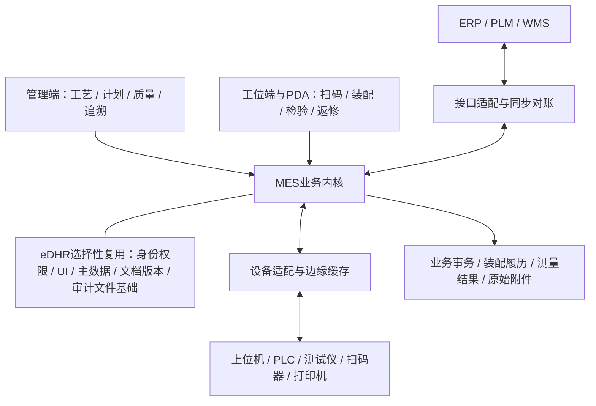

# 模组 / PACK MES 产品蓝图 v0.2

日期：2026-10-22｜状态：标准功能页面与无电子签名方向已确认；新项目工艺待确认。

本蓝图依据两份本地材料与eDHR固定版本源码；飞书正文尚未取得。来源编号及限制见[调研报告](../research/materials-and-reuse-assessment.md)。用户已确认使用配置化标准功能页面，取消通用表单及电子签名认证。具体规则和优先级仍为方案建议。开发时同时阅读[逐项复用审查](../architecture/edhr-reuse-audit.md)、[PACK行业设计](pack-domain-design.md)、[对象/接口/验收契约](../development/contracts-and-acceptance.md)。

## 1. 产品定位与边界

为模组与PACK装配工厂提供从电芯/模组接收到成品下线的执行、防错、质量与追溯能力。核心交付结果是：每个成品能解释“用了什么、在哪里加工、依据什么版本、测得什么、发生过什么异常、为何允许流转”。

首版以单客户私有化部署为默认设计假设，同时允许配置多条产线和多种产品。是否需要多工厂统一管理、跨厂调拨或SaaS多租户，单独确认。

| 系统 | 建议职责 | 与MES的关系 |
|---|---|---|
| ERP/PLM | 订单、物料、产品、设计BOM及其受控版本，具体主责按项目确定 | 下发工单/主数据，接收报工和消耗；同步失败可重试和对账 |
| 模组/PACK MES | 制造路线、工位执行、投料校验、装配关系、过程质量、在制与履历 | 对生产动作和业务放行作出可追溯判断 |
| 设备上位机/PLC/网关 | 设备运行、测量、程序执行、现场缓存与握手 | 接收业务许可/配方请求，上传实际结果；机器安全联锁仍由设备控制系统负责 |
| WMS/QMS/EAM（如果已有） | 仓储、质量体系、设备维护的相应职责 | MES先提供生产现场必要能力，按边界交换数据 |

上述职责划分参考[ISA-95官方介绍](https://www.isa.org/standards-and-publications/isa-standards/isa-95-standard)，并根据本项目目标提出。它不是要求一期实现完整ERP、APS、WMS、QMS、EAM，也不是标准认证声明。

一期默认不覆盖匀浆、涂布、辊压、注液等电芯制造过程；需要时接收上游电芯合格状态与关键参数。高级自动排产、配组优化算法、完整设备维保、AI预测和电池护照另行立项；已知明确客户要求可以改变排序。

## 2. 可标准化的产品结构

这是一张职责图，不意味着每个方框都应成为微服务。初期建议保持现有模块化单体，设备适配根据现场网络独立部署；通过明确服务接口与数据所有权减少耦合。

| 层次 | 标准化什么 | 允许变化什么 |
|---|---|---|
| 通用基础 | 用户、授权、审计、版本、附件、业务审批 | 角色、明确业务字段、审批角色、报告样式；无通用表单和电子签名 |
| MES内核 | 单件身份、访问工位、判定、装配绑定/拆换、库存事务、质量锁定、复测 | 经版本管理的业务规则；不能关闭身份唯一性与原始证据保留 |
| 工艺模板 | 路线→工序→标准动作；扫码、检验、涂胶、保压、焊接、锁附、静置、测试、装配、包装 | 顺序、参数、位置、数量、设备组、时间要求、A/B型差异；首版不引入独立作业流程设计器 |
| 项目适配 | ERP映射、设备协议、打印驱动、外部报表 | 厂商字段和项目特有接口，通过适配层实现 |

“标准化”应表现为同一动作和规则在不同产品配置下可运行。不能用“每换一个客户复制一套页面和数据库表”作为标准产品策略。

## 3. 主流程与两类工艺模板

通用业务链：

`制造版本发布 → 工单/派工 → 接料与上料 → 工位进站 → 加工/采集/装配 → 判定与出站 → 不良处置/返修复测 → 成品下线与履历 → 包装/入库交接`

工艺模板与系统业务链分开定义。下列是依据历史材料提炼的起始模板，不作为新产线冻结路线。

| 模板 | 工序示例 | 数据重点 | 来源 |
|---|---|---|---|
| 模组装配 | 电芯检验/OCV/IR → 清洁/贴片/涂胶 → 堆叠绑定/保压 → 绝缘检测/极柱处理 → CCS安装/焊接 → 静置 → 电性能/绝缘耐压/DCR → 防护/称重/下线 | 电芯来源、位置与数量、A/B型、胶料批次、测量和焊接结果、复测记录 | S2第3–5页 |
| 历史模组增补线 | 上料 → 清洗 → 组件堆叠 → 侧缝焊接 → EOL第一检测 → 顶盖焊接/CCS绑定 → EOL第二检测 | 工单匹配、过点、设备与MES双判定、换芯记录 | S1第4章 |
| PACK装配 | 箱体上线/部件预装 → 模组入箱与关联 → 冷却/电连接/锁附 → 液冷气密/绝缘 → 静动态测试 → 涂胶/合盖 → 整包气密/终检 → 容量测试/称重 → 包装入库 | 模组安装位置、关键件批次/SN、BMS信息、锁附与气密结果、线外测试交接 | S2第7–8页；S1 P0623–P0631 |

第三行是产品模板层面的分组，实际先后以发布路线为准；例如S2中EOL分布于不同位置，不能简单压缩成“最后测一次”。相同类型的多台测试设备可归于资源组，满足其中一台的合格测试，不表示可跳过其它必需测试项。

外购模组直接进入PACK时，系统应记录可获得的模组及供应商证据；供应商未提供电芯明细时，履历明确显示追溯深度，不能生成虚假的电芯层关系。

## 4. 关键业务对象

| 对象 | 最少应表达的含义 | 设计约束 |
|---|---|---|
| 产品制造版本 | 产品、BOM、路线、标准动作、参数规范、装配/电气映射、SOP及生效范围 | 启动生产时冻结实际使用版本；无需DHR/表单模板；发布不静默覆盖在制品 |
| 工序与工位 | 工序是业务步骤，工位是执行位置，设备是资源 | 一个工序可在多个合格工位执行；设备换位不改变历史记录 |
| 工单与派工 | 要做什么、数量/时间；分配到哪条线/班次 | 上层订单、派工和工位当前任务分开；换单需处理未完成作业和剩余料 |
| 追溯对象 | 电芯、模组、PACK、关键序列化部件；批次物料另按批管理 | 序列号具有明确命名空间和唯一性；供应商码可作为别名 |
| 装配规范 | 某父件需要哪些子件、位置、数量、型号/方向 | 从BOM与工艺派生，并保留版本；位置不能只用自由文本填写 |
| 装配关系 | 哪个子件在何时装入哪个父件的哪个位置 | 关系有生效与结束时间、操作来源和原因；禁止删除历史关系 |
| 工位作业/访问 | 某SN某次到某工位执行某工序 | 用访问ID区分初次、复测和返修；通信重传继续引用同一次访问 |
| 测量与测试运行 | 参数、值、单位、位置/通道、设备、规则版本、结果 | 设备原始值、标准化值及换算信息可追溯；缺测不能默认为OK |
| 物料批与线边余额 | 来源批次、容器、数量、单位、效期和质量状态 | 台账管理接收、上料、消耗、退料、报废、调整，余额不能由报表反推 |
| 质量锁定/处置 | 为什么拦截、覆盖哪些对象、如何处置 | 记录登记、评审、授权和关闭；解除锁定不删除失败证据 |
| 返修单 | 返修原因、对象、允许路线、拆换件、复测要求 | 返修是受控任务，不能只把当前工序改回前一工序 |
| 接口消息 | 来源、唯一事件ID、内容摘要、业务关联、处理与回执状态 | 相同ID相同内容重传返回原结果；相同ID不同内容转冲突处理 |
| 成品履历 | 成品某次放行/交付时的装配、工艺、质量与处置证据 | 借鉴冻结/清单机制另建MES报告；不依赖DHR表单归档；制造完工、质量放行、入库分别管理 |

建议电芯、模组、PACK统一用“追溯对象 + 类型 + 装配关系”表达，避免新增三套互不相通的追溯系统。是否共用eDHR的`production_object`实体，需要先验证外购物料、跨工单装配及DHR创建开销；外购电芯不应被迫创建虚拟内部生产工单。

不要把SN的所有状态塞进一个枚举。例如一个PACK可能“工序已完成 + 质量待处置 + 仍在库位A”，三个维度都需要真实存在。拆出的电芯也不能因关系已解除就自动变成可用库存。

## 5. 必须明确的运行规则

### 5.1 进站与出站

进站检查建议依次覆盖：对象存在与类型、可用状态、目标工单/投料授权、路线可达性、前置质量条件、工位/设备能力、人员权限/资格、装配/物料与首件要求。拒绝时返回业务原因码和可执行的处理建议，并记录拒绝事实。

通过后建立工位访问，绑定工序节点、设备/通道、生产会话和使用版本。出站时核对必需测量是否齐全、设备判定、MES规则判定、装配完整性及质量锁定。NG也产生真实执行记录，但不会取得下一关口的通行资格。

建议结果至少区分`待数据`、`合格`、`不合格`、`采集/解析异常`。若某步骤不适用设备判定，必须在规范中明确为“不适用”；没有收到结果不能自动按不适用处理。偏差放行是一条独立授权，不能把原始NG改写成OK。

### 5.2 装配与拆换

以模组绑定电芯为例：扫描父件 → 加载该版本的装配位置 → 校验子件型号、质量、已装配状态及分配关系 → 逐位置绑定 → 核对完整性 → 提交。

建议在服务端事务和数据库约束中保证：同一子件同时只归属一个有效父件、同一位置满足数量约束、并发请求不会重复占用、父子链不存在循环。对数量型物料记录实际消耗，对序列化部件同时记录装配关系，两者不能相互替代。

更换时结束旧关系并创建新关系，记录返修单、拆出/装入时间、人员、物料去向和待复测步骤。查询可分别展示当前装配、某时点装配、出厂装配以及完整变更历史。

### 5.3 测量、规则与更正

测试记录关联`对象 + 工序访问 + 设备/通道 + 参数/测试项 + 位置 + 测试运行ID + 时间`。对于单体电压等数组，保留通道/位置明细，不只保存最大值、最小值、平均值。

参数规范包含名称、数据类型、单位、上下限、精度/舍入、适用产品/工序、是否必需、采集来源和判定策略。具体数值由工艺资料确认。样例截图中的“2、3、22334”等不作为配置值。

原始数据更正必须新增关联记录，保留更正前内容、原因和授权。设备重测生成新的测试运行，选择哪次作为有效放行依据由明确策略决定；不能无条件选择任一次合格结果掩盖历史失败。

### 5.4 重传、扣料与断网

通信采用可重试交付，业务层做到幂等；不宣称网络天然保证“只收到一次”。同一业务事件只能生成一次扣料、绑定和出站效果。

工位出站相关的状态、装配和扣料应在同一业务提交边界内一致成功，或进入明确的待处理状态。给设备的业务成功回执只能在可靠落盘后发出；若回执丢失，重传查询原处理结果。设备的物理加工无法随数据库回滚，需有异常核对入口。

断网策略须按工位确认：关键关口默认不自动授予新的放行；若需要离线生产，明确可使用的本地版本、允许对象、有效期、缓存容量、质量责任和恢复对账。缓存补传本身不等于已经具备离线放行能力。

## 6. 页面与角色设计

管理端选择性复用eDHR框架；工位端保留工作台布局与扫码/SOP等交互，中央根据当前工序加载标准功能页面。页面有明确业务输入和规则，不依赖通用表单设计器。人工检验项可配置，但只能使用已定义检查类型和判定规则。以下为功能级规格；尚未进行视觉原型制作。

| 页面/工作台 | 主要使用者 | 核心信息与动作 | 关键反馈 |
|---|---|---|---|
| 产品与工艺配置 | 工艺工程师 | 产品/BOM、路线、参数、装配位置、设备组、SOP；草稿、校验、发布、版本比较 | 发布前显示缺项与影响范围；已投产版本有引用保护 |
| 工单与派工 | 计划员/班组长 | 订单来源、产品版本、计划/已产/在制；派线、调整、暂停、换单、完工 | 变更影响在制品时给出对象范围和限制 |
| 工位执行 | 操作员 | 固定工位/设备/工单上下文、大扫码框、当前SN、下一动作、测量结果、近期处理记录 | 明确允许/拦截及原因；区分待设备、待数据、超时和失败；扫码后保持焦点 |
| 组装绑定 | 装配人员 | 父件、位置示意、已绑/应绑、A/B型或方向、缺件；逐件扫码与完成校验 | 重扫、错型、已被占用、位置错误即时反馈；未经授权不能拆换 |
| 线边物料/PDA | 配料员/操作员 | 扫描容器与工位；接收、上料、退料、清料、余量、效期 | 单位、批次、效期与BOM校验；扫码成功有声音/视觉反馈 |
| 质量与返修 | 检验员/质量负责人/维修人员 | 待处理SN、失败测量、当前装配、处置记录；隔离、复测、返修、换件、报废、授权 | 原始值与新结果并列，展示重测次数和未完成复测；角色分工明确 |
| 单件履历与追溯 | 质量/工艺/售后 | 扫任意电芯/模组/PACK；父子树、工序时间线、参数、物料、异常；反查受影响成品 | 当前/历史/出厂视图可切换；缺失证据标记明确；导出带版本 |
| 产线与接口监控 | 班组长/运维 | 在制、质量待处置、产出、设备连接、待传消息、冲突消息、同步对账 | 异常可下钻到SN/工单/消息；重试动作有幂等与权限控制 |

建议操作员负责现场执行；质量角色负责不良处置和偏差批准；工艺角色维护版本；运维负责连接、重传与诊断。系统管理员不因管理账号就自动取得工艺结果改判权限。具体职责分离程度以人员组织确认。

## 7. 与 eDHR 的结合方式

### 7.1 先复用的能力

- 前后端工程、通用列表/弹窗、扫码与SOP展示等组件；AppLayout需去强制签名和旧菜单。
- 登录/角色/部门、物料/单位、工序/路线、文档版本、车间与设备档案；按MES范围扩展。
- 文件和审计基础；关键业务补对象授权、前后差异与一致提交保障。
- 版本冻结、来源清单和查询展示的可用机制；原DHR归档与通用审批服务不原样复制。

不引入通用表单设计器、字段画布、表单流程/投影、独立作业模板中心、DHR专属填报/汇总流程、电子签名/认证/身份证OCR。普通输入框、校验库和输入布局组件可以继续使用。

### 7.2 需要新增或改造的能力

- 单件过站和工位会话；设备身份与机器接口；独立测量/测试运行记录。
- 装配关系及位置、跨层级追溯、拆换历史和追溯范围计算。
- 制造BOM、物料可用性、线边库存与扣料事务。
- SN产出与质量统计、返修复测、质量锁定与解除、断网恢复对账。

在MES中建立明确领域服务，统一校验人工和设备动作。工序内标准动作负责装配、测试、锁附、人工检查等页面交互；装配唯一性、扣料、过站和结果有效性由后端执行。业务审批使用登录身份、角色、意见与审计，不要求电子签名。

现有`ProductionExecutionService`在执行时创建/联动DHR，配置与数据库也强制依赖DHR模板。新MES需解除该链路，采用独立工位访问/动作运行/测量记录；成品履历直接引用结构化过程证据，报告按模板生成，无需创建DHR或表单实例。整对象JSON及工单锁仅作为参考，真实吞吐须按节拍验证。

### 7.3 数据与部署

首版建议使用现有PostgreSQL保存核心事务、装配关系、测量摘要和索引；曲线、图片及原始文件放文件/对象存储，通过受控引用关联。是否需要独立时序数据库，应依据实际采样量和查询负载决定。

生产可用性、备份恢复、发布窗口和数据保留应形成可验证指标。至少确认峰值事件量、进站/出站响应要求、最大停网时长、恢复目标和保留期限；材料没有给出足够数值，本版不虚构容量承诺。

## 8. 分阶段实施与退出条件

| 阶段 | 交付内容 | 验证通过后再进入下一阶段 |
|---|---|---|
| A：边界与样本确认 | 补齐飞书、新项目路线、设备协议、产品/BOM/条码样本、接口职责；选一款产品 | 工艺节点、对象层级、版本、判定与返修规则能由具体样本解释 |
| B：复用验证切片 | 按逐项清单建立独立MES工程/新库；去签名/表单/DHR强依赖；最小模组+PACK链路先用模拟设备 | 无任何表单/DHR/作业模板可执行扫码→绑定→采集→NG拦截→换件→复测→追溯；SN产出正确 |
| C：首条真实产线 | 完善必要物料事务、实际设备适配、ERP/上游数据、打印、首检与异常流程 | 真实握手、超时、断网、重传、并发扫码、质量拦截和现场UAT通过 |
| D：产品标准化验证 | 增加另一种产品/路线，验证配置包与接口适配边界 | 无需复制业务引擎即可切换不同装配数量、A/B型、工序顺序、测试项及设备组 |
| E：增强模块 | 根据需求增加OEE、SPC、配组优化、维保、跨厂协同等 | 数据来源、统计口径和业务收益明确，再进入开发 |

阶段B是验证闭环的工程切片，不代表省略阶段C上线必需的功能。P0功能也不需要同一天全部开工，应沿这一闭环逐步实现。

## 9. 首个验证切片的验收脚本

使用测试电芯C001/C002、模组M001/M002、PACK P001作为演示标识；数量仅为测试夹具，不代表真实产品配比。

1. 发布测试制造版本V1，创建模组/PACK不同工单，登记电芯或上游合格证据。
2. 在指定工位开始任务，扫描与工单/型号不匹配的对象，确认拒绝且原因可查。
3. 把电芯装入M001；同一电芯再次绑定M002应失败；并发绑定仍只能一个成功。
4. 上传一次测试NG，执行事实被保存，下道工序被拦截；设备NG、MES结果及原始数据分别可查。
5. 对同一消息重传，确认记录、扣料和产出都不重复；同ID内容改变进入冲突队列。
6. 创建返修单，拆出异常电芯、装入替换电芯；拆出件进入明确质量/库存处置，所需复测重新打开。
7. 完成复测，按批准策略恢复流转；原始NG和旧装配关系仍可查询。
8. 将合格模组绑定到P001的指定位置，核对模组来源工单与PACK目标工单关联，完成关键测试。
9. 下线后分别验证生产完工、质量放行和入库交接状态；SN产出只计一次，初测通过率不因复测合格被改写。
10. 从电芯正查PACK、从PACK反查电芯，比较返修前/后与出厂快照，导出完整履历。
11. 在配置V2发布后查询V1在制品及历史记录，实际使用的路线、BOM与阈值不发生静默变化。
12. 模拟网络/回执丢失及服务重启，恢复后业务结果一致；没有授权的离线关口不自动放行。

这是拟定验收方案，尚未执行。真实产线须增加具体设备协议、数据规模及人员操作验收。去表单/作业中心/电子签名的验收，以及胶料、点位、BMS、气密、长时测试等行业验收详见[AC01–AC21](../development/contracts-and-acceptance.md#6-开发验收清单)。

## 10. 下一轮最需要确认的内容

| 优先 | 问题 | 决定什么 |
|---|---|---|
| 1 | 下一项目是仅模组、仅PACK，还是两者？是否自产电芯/外购模组？ | 首期边界、追溯深度、对象来源 |
| 2 | 哪条线先上线，手动/半自动/全自动程度如何？设备/上位机由谁提供？ | 工位端交互、网关职责、联调投入 |
| 3 | 产品型号、串并联/装配数量、A/B型和安装位置规则是什么？是否允许跨批/跨工单？ | 装配规范、物料兼容性和配组规则 |
| 4 | 最终路线、参数/单位/阈值、测试有效期、重测和换件后的复测要求是什么？ | 判定、拦截和返修闭环 |
| 5 | ERP/WMS/PLM/已有MES分别管理哪些主数据和库存？是否已有接口？ | 数据主责、同步方式、对账和一期临时导入方案 |
| 6 | 产线数、峰值节拍、设备事件频率、曲线/图片规模、保留年限与断网政策？ | 数据结构、容量、部署及恢复设计 |
| 7 | 首期验收日期与明确必须交付的报表/功能有哪些？ | 里程碑和范围取舍；此后才可可信估算排期 |

飞书文档可在访问恢复后读取，或由用户提供导出文件/正文；补齐后应对本版的范围、工艺、模块优先级做差异评审。
